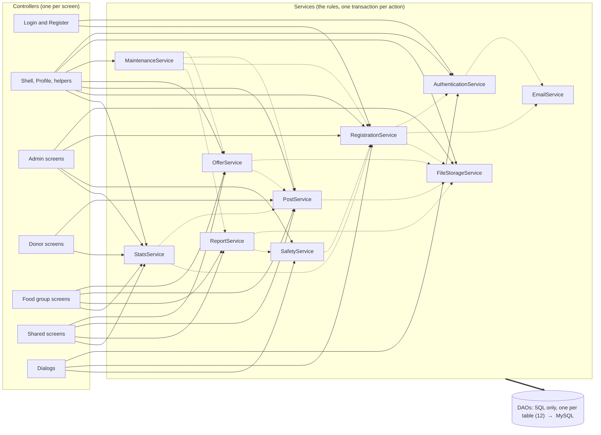

# Call graph

Generated by `python3 scripts/callgraph.py` from the source, so it shows what the code does, not what was planned.
A solid arrow is "calls"; a dotted arrow is one service using another; the thick arrow is every service reaching its DAOs (table below). Nothing points up: no DAO calls a service, no
service calls a controller, and no controller calls a DAO (`ArchitectureTest` fails the build if one does).

## Size

| Layer | Files | Lines |
|---|---|---|
| controller | 42 | 4555 |
| service | 11 | 2330 |
| dao | 12 | 1830 |
| model | 15 | 571 |
| util | 9 | 578 |
| view (FXML) | 30 | 3409 |

## Which DAOs each service uses

| Service | DAOs |
|---|---|
| AuthenticationService | AccountDao |
| EmailService | LogDao |
| FileStorageService | none |
| MaintenanceService | none |
| OfferService | AccountDao, DetailDao, LogDao, OfferDao, PhotoDao, PostDao |
| PostService | DetailDao, LogDao, OfferDao, PhotoDao, PostDao |
| RegistrationService | AccountDao, CityDao, DocumentDao, LogDao, RegistrationDao |
| ReportService | OfferDao, PhotoDao, PostDao, ReportDao |
| SafetyService | LogDao, OfferDao, SafetyNoticeDao |
| StatsService | AccountDao, DocumentDao, HistoryDao, OfferDao, PostDao, RegistrationDao, ReportDao, SafetyNoticeDao |

## Reading it

- A controller area reaches a service by name only; it never sees SQL. The edges from Dialogs are the popups' buttons.
- `MaintenanceService` is the one service that only calls other services (A4).
- A service-to-service arrow means the second one owns the rule: `SafetyService` suspends through `RegistrationService`,
  `ReportService` raises its overdue flag through `SafetyService`, and `OfferService` and `PostService` share status changes.
