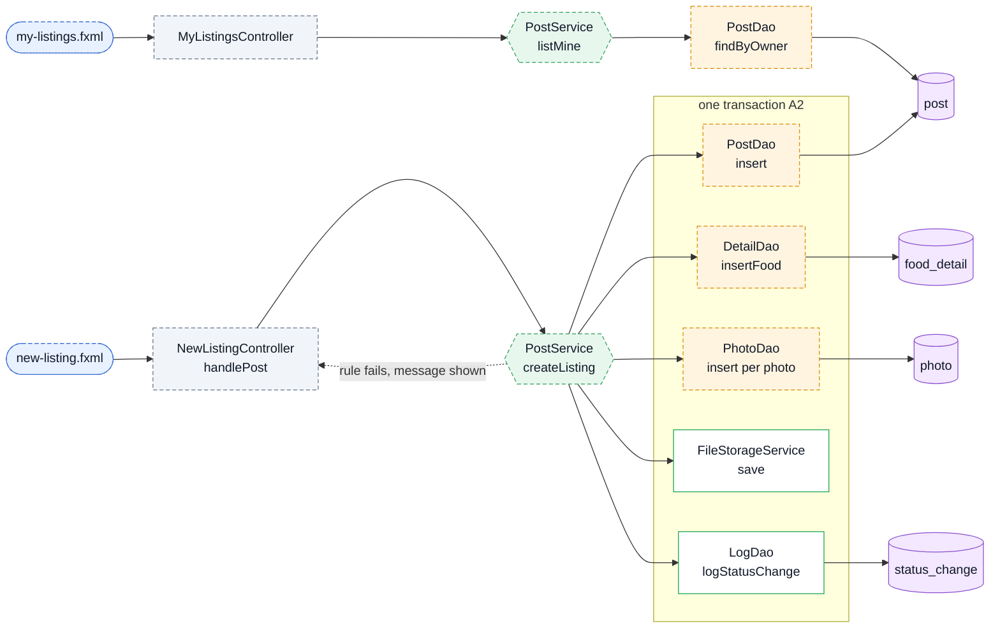
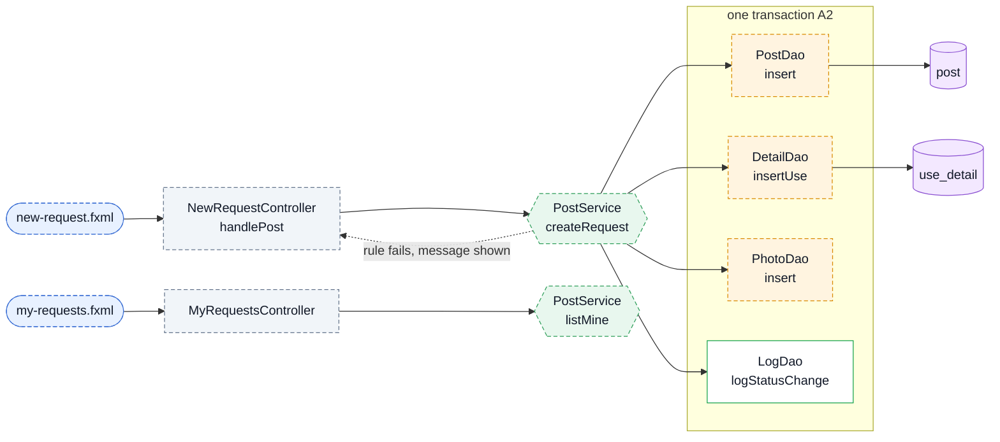
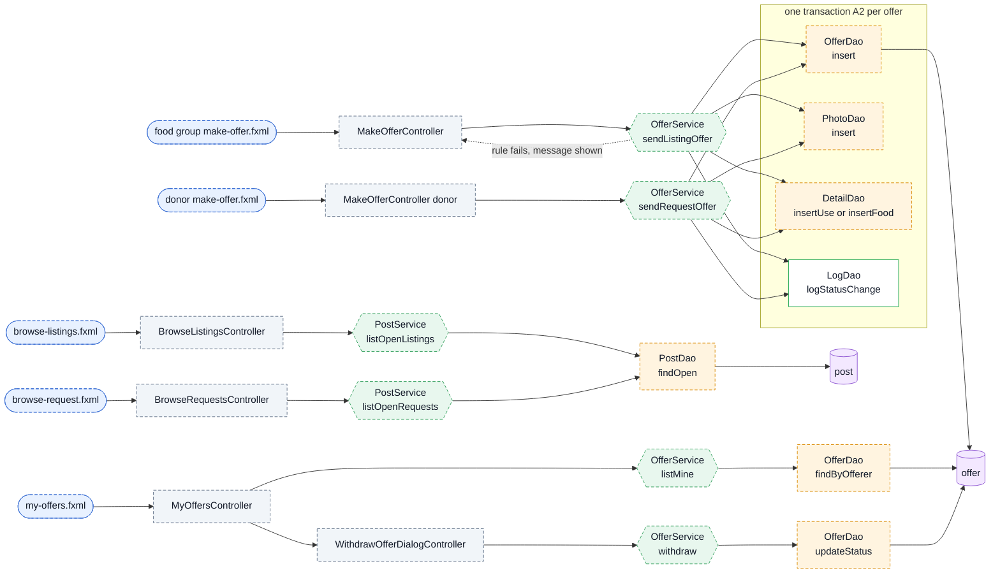
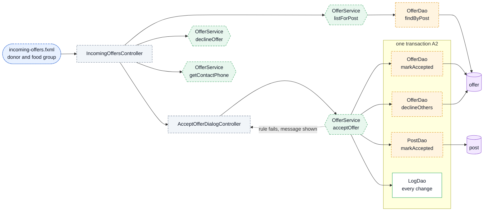
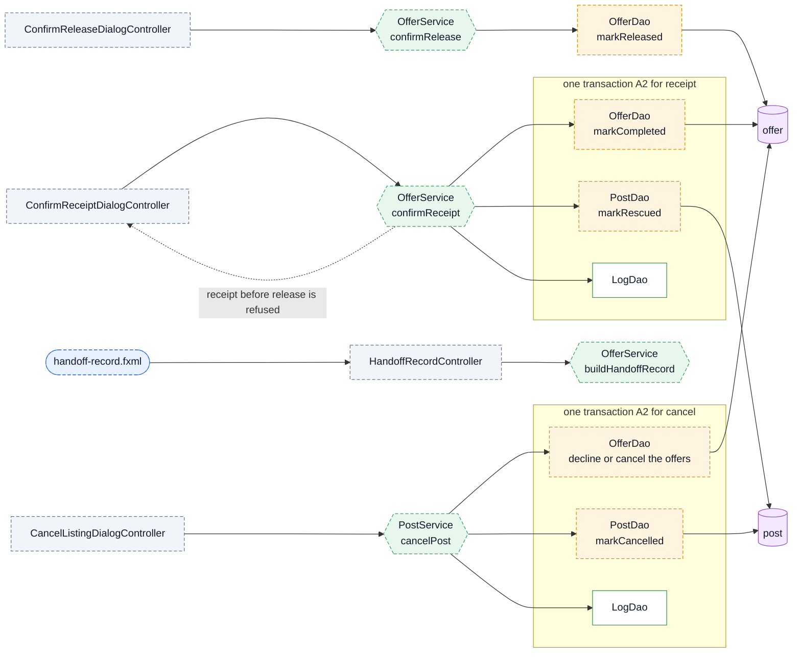
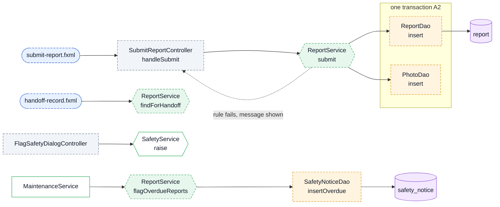
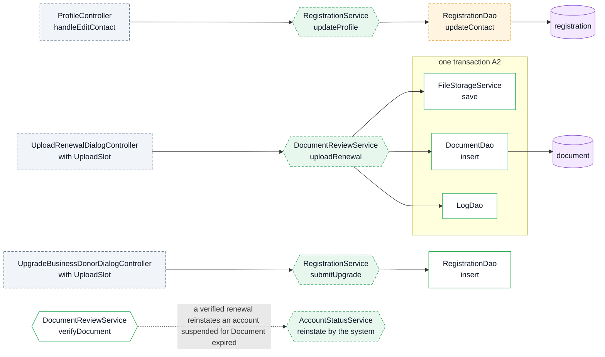
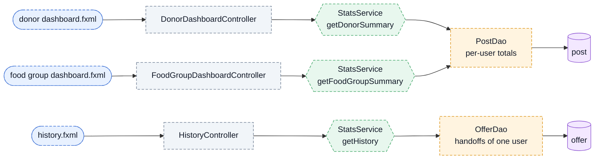

# ANIPLATO Feature Flows

One diagram per feature: the call chain, then what is still to build. Build in this order. Spec stage numbers refer to `Project Spec.md`.
Notation: `Screen → Controller.handler → Service.method → Dao.method → table`. `⚠` = throws `RuleViolationException` (shown by `DialogController.showError`).

## Conventions
- **C1** A feature's chain is written here before its code.
- **C2** Touch only files in the chain. Create a file only when a chain needs it.
- **C3** Controller: one `@FXML` handler per button; read input → one service call → `Navigator.show` or bind result; `catch RuleViolationException` → `DialogController.showError`.
- **C4** Service method: validate (⚠) → `Database.inTransaction("message", c -> { DAO calls; LogDao.logStatusChange if a status changes })` for anything that writes. A read-only method uses `try (Connection c = Database.getConnection())`. `SQLException` becomes `DataAccessException`. Never write your own commit/rollback.
- **C5** DAO method: takes a `Connection`, `PreparedStatement`, no rules.
- **C6** Model: fields only for existing schema columns; status enums nested.
- **C7** Service = verb phrase (`sendOffer`); DAO = `findX` / `insert` / `updateX`.
- **C8** Rule ID in a comment only where the rule is enforced.
- **C9** One service calling another inside the same transaction passes its `Connection` (existing pattern: `AccountStatusService.suspend(Connection, ...)`, used by `SafetyService`).

Tags: **[built]** exists, fits the schema and has tests · **[new]** does not exist yet. The old **[stale]** code (the `listing` model) was deleted in the cleanup.

**What exists today is in MAP.md (removed; see [GUIDE.md](GUIDE.md)); how to build the rest is the Blueprints section at the end of this file. The code is the map now: read [GUIDE.md](GUIDE.md) first.**

## Screens (Figma file H5M7MWgWL1sqJMN3dZ8PyF, page "V2 (edited)", is the source of truth)
Figma frames that differ by role or account type are **variants of one shared screen** (A5: the screen never checks role; differences come from the Account subclass or the data). The spec's 7.2 tree is outdated; Figma wins.

| Shared screen | Figma variants it covers |
|---|---|
| login, set-new-password dialog | Log in · Set New Password |
| register, register-step2, register-submitted | Step 1 (Business / Casual / Food group) · Step 2 (3 variants) · Submitted |
| shell, dashboard | Admin / Donor / Food group dashboards · donor Suspended view · (AI chat: stretch) |
| profile | Admin / Donor (Business, Casual) / Food group profile · Upload Renewal / Upgrade dialogs |
| my-posts | Donor My Listings · Food group My Requests |
| post-offers | Donor Incoming Offers · Food group Offers Received |
| my-offers | Donor My Offers · Food group My Offers |
| browse | Food group Browse Listings · Donor Browse Requests (Business / Casual) |
| new-post | Donor New Listing (Business / Casual) · Food group New Request |
| make-offer | Food group Make Offer · Donor Make Offer |
| history, handoff-record, submit-report | History (donor / food group) · Handoff Record (donor / food group) · Submit Report |
| Admin only | pending-registrations · review-registration (Business / Casual) · accounts · safety-notices · reports |
| Dialogs (DialogController) | Cancel Post · Accept / Withdraw Offer · Flag Concern · Confirm Release / Receipt · Approve / Reject Org · Suspend / Reinstate / Resolve Notice |

Chains below name screens by their Figma role names; where a chain says "donor/..." or "foodgroup/..." read it as the shared screen above. Frame IDs are in the Figma metadata (e.g. `480:2472` My Listings).

---

# Integration Roadmap (build order, screen by screen)

Each module wires screens that already exist in FXML to the call chains below (the "Chain" column points at the numbered feature sections). We write only the backend pieces a module needs and adjust controllers as we go. `[FE]` = screen not yet delivered by the frontend.

| # | Module | Screens wired | Backend we write | Chain | Needs first |
|---|---|---|---|---|---|
| 1 | **Login** (in progress) | login, Set New Password dialog, shell, logout | done; fix issues found in click-through | 1, 11 | none |
| 2 | **Registration** | register, register-step2, register-submitted | wire `checkDetails`, `submit`, `cities`; real city list, file picker, expiry dates, consent, Received email | 2 | 1 |
| 3 | **Admin review** | pending-registrations, review-registration, approve/reject dialogs | `RegistrationService`: `listPending`, `getForReview`, `verifyDocument`, `approve`, `reject`; new DAO methods; document preview | 2 | 2 |
| 4 | **Profile, accounts** (built in round 4; the upgrade and edit are in `ProfileService`) | profile, accounts, suspend/reinstate/renewal/upgrade dialogs | `updateProfile`, `uploadRenewal`, `submitUpgrade`, `suspend`, `reinstate`, `listAccounts` | 8 | 3 |
| 5 | **Post a listing** (built in round 3) | new-listing, my-listings, cancel dialog | `Post`/`FoodDetail`/`Photo` models, `PostService`, `PostDao`, `DetailDao`, `PhotoDao` | 3a | 4 |
| 6 | **Browse and offer** (built in round 3) | browse-listings (food group), make-offer, my-offers (shared) | `OfferService.sendListingOffer`, `withdraw`, `listMine`; rewrite `OfferDao` | 4 | 5 |
| 7 | **Accept offer** (built in round 3) | incoming-offers, accept/decline dialogs | `acceptOffer`, `declineOffer`, phone-reveal method (A7) | 5 | 6 |
| 8 | **Handoff** (built in round 3) | confirm release/receipt dialogs, handoff-record, history | `confirmRelease`, `confirmReceipt`, `buildHandoffRecord`, `cancelPost` | 6 | 7 |
| 9 | **Requests (Route 2)** (built in round 3) | new-listing as request, browse-request (donor), donor make-offer, `[FE]` my-requests, `[FE]` offers-received | `createRequest`, `sendRequestOffer`, `UseDetail`; reuses modules 5 to 8 | 3b, 4 | 8 |
| 10 | **Report and safety** (built in round 3 (the Flag Concern dialog is not wired)) | `[FE]` submit-report, flag-concern dialog, safety-notices, resolve dialog | `ReportService`, `ReportDao`; let `SafetyNoticeDao.insert` take a notice with no raiser (the overdue kind) | 7 | 8 |
| 11 | **Dashboards, history, reports** (built in round 4; `DashboardService`, `HistoryService`) | three dashboards, history, admin reports | `StatsService`; all values derived (A9) | 9 | 8, 10 |
| 12 | **Maintenance** (built in round 3) | all screens (runs on screen load) | rewrite `MaintenanceService`, re-attach to the shell | 10 | 5 to 10 |
| 13 | **Seed and polish** (built in round 4 except the AI chat stretch) | whole app | demo seed, README, AI chat (stretch) | 12 | all |

**Per-module loop**
1. Read the Figma frame text and the FXML `fx:id`s.
2. Add the missing service and DAO methods.
3. Wire the controller: read input, one service call, then navigate or bind the result.
4. Check the service headless against MySQL, then click through the screen.
5. Commit with the module number; push after the click-through passes.

**Order rules**
- A module starts only after the previous one passes its click-through.
- `[FE]` screens in modules 9 and 10 are blocked until delivered; modules 1 to 8 are not.
- Modules 9 and 10 mostly reuse earlier work.

---

## How to read the diagrams

Dashed boxes are **planned**; a solid green outline is something that **already exists** and is reused. Colours: blue = screen, grey = controller, green = service, orange = DAO, purple = table. A dotted arrow back to the controller is a broken rule shown as a message. Method names are proposals (C7). The built features have their diagrams in MAP.md (removed; see [GUIDE.md](GUIDE.md)) section 5 (AUTH, REGISTER, REVIEW, ACCOUNTS, PROFILE, SAFETY, STATS, MAINT, SHELL, POPUPS, PLATFORM).

## 1. Login: built
See MAP.md, AUTH. Nothing to build. A temporary password (R1.7): `LoginController` asks `AuthenticationService.mustChangePassword()` and opens the Set a new password dialog; `Navigator.show` keeps the shell closed while the password is temporary, and Back on that dialog logs out.

## 2. Register and approve: built
See MAP.md, REGISTER and REVIEW. Nothing to build.

## 3a. Post a listing (Route 1): Stage 2A

> **Built in round 3.** The diagram below is the original plan; the real call chains and tests are in MAP.md (removed; see [GUIDE.md](GUIDE.md)).

Rules: account Active and documents current, kg above 0, use-by in the future, window ends before use-by, 1 to 5 photos, category allowed for the role, storage set, attestation ticked. Rows on My Listings lead to Review offers (module 7), Confirm Release (8) and Cancel (8).

**Status:** [new] `Post` and `FoodDetail` models, `PostService`, `DetailDao`, `PhotoDao`; `PostDao` exists but holds only the dashboard totals. The old `Listing*` code was deleted in the cleanup.

## 3b. Post a request (Route 2): Stage 2B

> **Built in round 3.** The diagram below is the original plan; the real call chains and tests are in MAP.md (removed; see [GUIDE.md](GUIDE.md)).

Reuses everything from 3a. Rows on My Requests: Review offers, Confirm Receipt, Cancel request.

## 4. Browse and offer: Stage 3

> **Built in round 3.** The diagram below is the original plan; the real call chains and tests are in MAP.md (removed; see [GUIDE.md](GUIDE.md)).

Rules: listings and requests in the viewer's city first; posts from suspended posters hidden; a Casual donor sees only raw or sealed-packaged requests; one offer per account per post; Route 1 pickup inside the listing's window; Route 2 kg not above the request.

**Status:** the two `MakeOfferController`s stay two (a donor offer and a food group offer are different forms). `OfferDao` has only `findStatus`, `findParties` and the counts today.

## 5. Accept or decline an offer: Stage 4

> **Built in round 3.** The diagram below is the original plan; the real call chains and tests are in MAP.md (removed; see [GUIDE.md](GUIDE.md)).

`getContactPhone` is the only way a phone number is returned (A7): to the owner, an admin, or the other side of an Accepted, not yet closed offer. Offers from a suspended offerer are left out of `listForPost`.

## 6. Handoff, receipt and cancel: Stages 5 and 6

> **Built in round 3.** The diagram below is the original plan; the real call chains and tests are in MAP.md (removed; see [GUIDE.md](GUIDE.md)).

The record number is `HR-year-offer_id`, derived and never stored; it says it is not a government certificate. A Completed handoff cannot be cancelled.

## 7. Report and safety notice: Stage 5 (report), 6.3

> **Report built in round 3; the safety-notice part was already built.** The Flag Concern dialog is the one piece not wired. See MAP.md (removed; see [GUIDE.md](GUIDE.md)).

Resolving a notice is already built (MAP.md, SAFETY). The report is due 7 days after receipt; "submitted late" is derived (A9). `SafetyNoticeDao.insert` writes `kind`; the overdue notice has no raiser and no concern, so its insert must accept nulls for both.

## 8. Profile, renewals and upgrade: 6.3

List, suspend, reinstate, verify and the document lists are built (MAP.md, ACCOUNTS and PROFILE). The admin reaches a renewal from Accounts through Review (Figma: "Renewal uploaded, Review").

## 9. Dashboards, History, Reports: Section 3

All values are derived on read (A9). The admin dashboard and reports are built (MAP.md, STATS).

## 10. Maintenance: 6.6

> **Built in round 3.** The diagram below is the original plan; the real call chains and tests are in MAP.md (removed; see [GUIDE.md](GUIDE.md)).
Built and attached (MAP.md, MAINT). Each module below adds exactly one line to `MaintenanceService.runMaintenance`, at the position 6.6 gives it, with a test in `MaintenanceServiceTest`:

| Order | Line | Added by |
|---|---|---|
| 1 | `offerService.lapseOverdueAcceptedOffers` | module 8 |
| 2 | `postService.expireOverdueListings` | module 5 |
| 3 | `postService.expireOverdueRequests` | module 9 |
| 4 | `offerService.expireOverdueOffered` | module 6 |
| 5 | `reportService.flagOverdueReports` | module 10 |
| 6 | `accountStatusService.suspendAccountsWithExpiredDocuments` | built |

## 11. Shell, navigation, logout: A5
Built (MAP.md, SHELL). The sidebar matches Figma V2 for both roles and shows the donor's and food group's counts.

## 12. Demo data and finish
`sql/seed.sql` (one full loop per route, one expired post, one suspended account, per Spec section 5 Demo); README. The AI assistant (spec stretch) has Figma frames but stays out of this plan until everything above works. The donor Suspended restricted view is part of module 11.

---

# Blueprints: what to build, module by module

Read MAP.md (removed; see [GUIDE.md](GUIDE.md)) first (what exists), then your module here. Modules 1 to 3 are built and tested, so they have no blueprint.

**How to use one**
1. Give your AI `AGENTS.md` and your blueprint. Ask it to build **one layer at a time** (DAO, then Service, then Controller) and to list the files and the existing methods it will reuse **before** writing.
2. The method names under **Add** are proposals that follow C7. Change one only if you say so in the pull request.
3. Before opening the pull request run `scripts/new-methods.sh`. Every method it prints must be in **Add**; any other is an extra to explain or delete.
4. Turn each **Done when** line into a test (copy the pattern in `AccountStatusTest` or `SafetyServiceTest`: log in with `loginAs(...)`, call the service, check the tables). A teammate merges only after the author can explain the service method.

**Words:** *Add* = new methods, per layer. *Reuse* = exists, call it, do not rewrite. *Not here* = another module's job. *Owner* = fill in.

Every module also follows: one transaction per action (`Database.inTransaction`), a `LogDao.logStatusChange` for every status change (A3), controllers call services only (A1), no role checks in shared screens (A5), strings from Appendix A of the spec.

---

## Module 4: Profile and renewals (accounts list, suspend and reinstate are already built)
*Spec 6.3 (renewals, upgrade, profile). Owner: ___*

| | |
|---|---|
| **Add** | **Dao:** `RegistrationDao.updateContact(c, registrationId, person, phone)`. **Service:** `RegistrationService.updateProfile(contactPerson, contactPhone)` (phone must be 11 digits, same rule as `checkDetails`); `RegistrationService.submitUpgrade(List<DocumentUpload>, consent)` (Casual donor only; a new Pending registration with the same details and role Business, Mayor's and Sanitary permits required); `DocumentReviewService.uploadRenewal(Document.Type, File, LocalDate expiresOn, boolean noExpiry)` (only a type this registration already has; same file and expiry checks as `submit`). **Controller:** `ProfileController.handleEditContact`, plus the two dialog classes `UploadRenewalDialogController` and `UpgradeBusinessDonorDialogController` calling the services and choosing files with `UploadSlot`, the same row registration step 2 uses (the file buttons are placeholders today). |
| **Reuse** | `DocumentDao.insert`, `FileStorageService.save/validate`, `LogDao`, `RegistrationService.checkDetails` (extract the phone and email checks if you need them), `DocumentReviewService.verifyDocument` |
| **Not here** | Reinstating by hand, which is built. The admin side of an upgrade is `approve`, built. |
| **Done when** | a renewal is a **new** document row awaiting review, and the old one is untouched · an expired date, a wrong type or a file over 5 MB is refused with the message · an upgrade by a Business or Admin account is refused · approving an upgrade changes the role and keeps the password (already tested in `RegistrationDecisionTest`) · a phone number that is not 11 digits is refused on edit · **spec 6.3:** when a renewal is verified for an account suspended with reason "Document expired" and no verified document is still expired, the account is reinstated by the system (add this to `DocumentReviewService.verifyDocument`, one transaction, logged with `changed_by` NULL) |

## Module 5: Post a listing (Route 1, Stage 2A)
*Built in round 3. Kept as the record of what was planned; the built methods are in MAP.md. Two differences: the accept and contact methods live in `AcceptanceService`, and release, receipt and the record in `HandoffService`, to keep every file under 300 lines.*

*Owner: ___*

| | |
|---|---|
| **Add** | **Model:** `Post`, `FoodDetail` (fields only for existing columns, enums nested). **Dao:** `DetailDao.insertFood`, `PhotoDao.insert(c, postId, path)`, `PostDao.insert`, `PostDao.findByOwner(c, accountId)`. **Service:** new `PostService.createListing(PostForm form, List<File> photos)` and `PostService.listMine()`. **Controller:** `NewListingController.handlePost`, `MyListingsController` rows and count (fix the missing `listingCountLabel` fx:id in `my-listings.fxml`, see `FxmlWiringTest`). |
| **Reuse** | `FileStorageService.save`, `LogDao`, `Settings.MIN_PHOTOS/MAX_PHOTOS`, `Session.require().canPostOrOffer()` |
| **Not here** | Cancel (module 8), browse and offers (6), requests (9), the sweep that expires listings (12). |
| **Done when** | rules of Stage 2A each have a test: kg above 0 · use-by in the future · pickup window ends before the use-by · 1 to 5 photos · category follows the role (a Casual donor may only pick raw or sealed-packaged) · storage condition required · attestation ticked · a Suspended account cannot post · a failed photo save leaves no post, no detail and no photo rows (one transaction) · the new post is Open and `status_change` has the row |

## Module 6: Browse and offer (Stage 3, both routes)
*Built in round 3. Kept as the record of what was planned; the built methods are in MAP.md. Two differences: the accept and contact methods live in `AcceptanceService`, and release, receipt and the record in `HandoffService`, to keep every file under 300 lines.*

*Needs 5. Owner: ___*

| | |
|---|---|
| **Add** | **Model:** `UseDetail`; complete `Offer` (id, post id, offerer, kg, status, times). **Dao:** `OfferDao.insert`, `findByOfferer`, `updateStatus`, `existsFor(c, postId, offererId)`; `PostDao.findOpen(c, kind, viewerCityId)`; `DetailDao.insertUse`. **Service:** `PostService.listOpenListings()`, `listOpenRequests()` (viewer's city first; suspended posters hidden; a Casual donor sees only raw or sealed-packaged requests); new `OfferService.sendListingOffer(...)`, `sendRequestOffer(...)`, `withdraw(offerId)`, `listMine()`. **Controller:** `BrowseListingsController`, `BrowseRequestsController`, the two `MakeOfferController`s (donor and food group are different forms, so they stay two), `MyOffersController`; wire `WithdrawOfferDialogController`. |
| **Reuse** | `PhotoDao.insert`, `DetailDao`, `OfferDao.findStatus`, `LogDao`, `FileStorageService` |
| **Not here** | Accept and decline (7), the sweep that expires unanswered offers (12). |
| **Done when** | one offer per account per post (the schema already enforces R3.1; the service must give a message) · pickup inside the listing's window and before its use-by · Route 2: kg not above the requested kg, category accepted by the request · a Suspended account cannot offer · offers from a suspended offerer and posts from a suspended poster are not listed · withdraw works only while Offered, and not after accept · listings in the viewer's city come first |

## Module 7: Accept and decline (Stage 4)
*Built in round 3. Kept as the record of what was planned; the built methods are in MAP.md. Two differences: the accept and contact methods live in `AcceptanceService`, and release, receipt and the record in `HandoffService`, to keep every file under 300 lines.*

*Needs 6. Owner: ___*

| | |
|---|---|
| **Add** | **Dao:** `OfferDao.findByPost`, `markAccepted`, `declineOthers(c, postId, keepOfferId)`; `PostDao.markAccepted(c, postId, agreedKg)`. **Service:** `OfferService.listForPost(postId)`, `acceptOffer(offerId)` (one transaction: this offer Accepted, every other Offered one Declined, post Accepted, agreed kg fixed, every change logged), `declineOffer(offerId)`, `getContactPhone(offerId)` (the **only** place a phone number is returned, A7). **Controller:** `IncomingOffersController` (donor) and `FoodGroupIncomingOffersController` (food group); wire `AcceptOfferDialogController`. |
| **Reuse** | `OfferDao.findParties/findStatus`, `LogDao`, `Database.inTransaction` |
| **Not here** | Handoff (8). |
| **Done when** | only the poster can accept or decline · only an Offered, unexpired offer can be accepted · accepting declines the others **in the same transaction**: a forced failure leaves everything unchanged · Route 1 agreed kg is the listing's, Route 2 the offer's · a Suspended poster cannot accept · `getContactPhone` returns a number only to the owner, an admin, or the other side of an Accepted, not yet closed offer, and no list query ever returns a phone number |

## Module 8: Handoff, receipt and cancel (Stages 5 and 6)
*Built in round 3. Kept as the record of what was planned; the built methods are in MAP.md. Two differences: the accept and contact methods live in `AcceptanceService`, and release, receipt and the record in `HandoffService`, to keep every file under 300 lines.*

*Needs 7. Owner: ___*

| | |
|---|---|
| **Add** | **Dao:** `OfferDao.markReleased`, `markCompleted`; `PostDao.markRescued`, `markCancelled`. **Service:** `OfferService.confirmRelease(offerId)`, `confirmReceipt(offerId)` (after release only; one transaction: offer Completed, post Rescued), `buildHandoffRecord(offerId)` (number `HR-year-id` derived, says it is not a government certificate); `PostService.cancelPost(postId, reason)` (Open or Accepted only; declines or cancels the offers, each offerer sees the reason). **Controller:** `HandoffRecordController`; wire `ConfirmReleaseDialogController`, `ConfirmReceiptDialogController`, `CancelListingDialogController`. |
| **Reuse** | `OfferDao.findParties`, `LogDao`, `Database.inTransaction`, `getContactPhone` |
| **Not here** | The report (10), the lapse when nobody comes (12). |
| **Done when** | receipt before release is refused · only the donor can release and only the food group can confirm receipt · confirming receipt completes the offer **and** rescues the post in one transaction · a Completed handoff cannot be cancelled · cancelling an Accepted post cancels its offer with the reason, an Open one declines every waiting offer · a Suspended account can still finish an accepted handoff |

## Module 9: Requests (Route 2, Stage 2B)
*Built in round 3. Kept as the record of what was planned; the built methods are in MAP.md. Two differences: the accept and contact methods live in `AcceptanceService`, and release, receipt and the record in `HandoffService`, to keep every file under 300 lines.*

*Needs 8. Owner: ___*

| | |
|---|---|
| **Add** | **Service:** `PostService.createRequest(...)`, reusing `listMine`. **Controller:** `NewRequestController`, `MyRequestsController`. **FXML:** `my-requests.fxml` rows ("Review offers", "Confirm Receipt", "Cancel request"). |
| **Reuse** | everything from modules 5 to 8, `DetailDao.insertUse`, `PhotoDao` |
| **Not here** | New shared logic: if a rule differs between the routes, branch on the post kind in the service, never on the user's role in a screen (A5). |
| **Done when** | kg above 0 · needed-by in the future · event date on or after the needed-by · 1 to 5 photos · group attestation ticked · several Open requests at once are allowed · a Suspended group cannot post |

## Module 10: Report and safety (Stage 5 report, 6.3)
*Built in round 3. Kept as the record of what was planned; the built methods are in MAP.md. Two differences: the accept and contact methods live in `AcceptanceService`, and release, receipt and the record in `HandoffService`, to keep every file under 300 lines.*

*Needs 8. Owner: ___*

| | |
|---|---|
| **Add** | **Model:** `Report`. **Dao:** `ReportDao.insert`, `findByOffer`. **Service:** new `ReportService.submit(offerId, ...)` (food group only, after receipt, one report per handoff, 1 to 5 photos, photo consent ticked; due 7 days after receipt and "submitted late" are derived), `ReportService.findForHandoff(offerId)`, `ReportService.flagOverdueReports(now)` (one notice per handoff, `kind = 'OVERDUE_REPORT'`, `raised_by` NULL, called by module 12); `SafetyNoticeDao.insertOverdue`. **Controller:** `SubmitReportController`; wire `FlagSafetyDialogController` to `SafetyService.raise`. |
| **Reuse** | `SafetyService.raise/dismiss/suspendFlaggedAccount` (built, tested), `ReportDao.sumPeopleServed` etc., `PhotoDao` |
| **Not here** | Anything that blocks the food group: an overdue report never blocks posting or offering. |
| **Done when** | a second report for the same handoff is refused · a Suspended group can still submit · submitting late works and shows "submitted late" · the overdue flag is raised once per handoff and never again · dismissing or suspending from that notice works (already tested for concerns) |

## Module 11: Dashboards, History, Reports
*Needs 8 and 10. Owner: ___*

| | |
|---|---|
| **Add** | **Service:** `StatsService.getDonorSummary()`, `getFoodGroupSummary()`, `getHistory()` (the signed-in user's handoffs, newest first). **Controller:** `DonorDashboardController`, `FoodGroupDashboardController`, `HistoryController`; the donor Suspended view. |
| **Reuse** | `StatsService.getAdminSummary/getReport` (built, tested), `PostDao`, `OfferDao` counts |
| **Not here** | Storing any total or rate (A9): derive on read. |
| **Done when** | a rate with nothing to divide by shows nothing, not 0% · numbers match a hand count on the seed · History lists only the signed-in user's handoffs |

## Module 12: Maintenance (6.6)
*Built in round 3. Kept as the record of what was planned; the built methods are in MAP.md. Two differences: the accept and contact methods live in `AcceptanceService`, and release, receipt and the record in `HandoffService`, to keep every file under 300 lines.*

*Needs 5 to 10. Owner: ___*

| | |
|---|---|
| **Add** | **Service:** a new `MaintenanceService.runMaintenance()` that **only calls other services** (A4), in this order: `OfferService.lapseOverdueAcceptedOffers`, `PostService.expireOverdueOpen`, `OfferService.expireOverdueOffered`, `ReportService.flagOverdueReports`, `AccountStatusService.suspendAccountsWithExpiredDocuments`. Each of those is added by the module that owns that status. Call it from `ShellController` on every screen load. |
| **Reuse** | `AccountStatusService.suspendAccountsWithExpiredDocuments` (built, tested) |
| **Not here** | Rules of its own. If it needs one, the rule belongs in the owning service. |
| **Done when** | one test per line of 6.6, using `TestDb.exec` to age the data · running it twice changes nothing the second time · a Suspended account's data is handled exactly as 6.3 says |

## Module 13: Demo data and polish
*Last. Owner: ___*

| | |
|---|---|
| **Add** | `sql/seed.sql`: one full loop per route, one expired post, one suspended account (Spec section 5). README. Wire the login screen's "Forgot password" link to `DialogController.showForgotPasswordMode` (the Profile screen already does). |
| **Done when** | a fresh `setup-db` and a click-through of the demo story works end to end · `mvn test` is green on the new seed (some tests assume today's seed: change both together) |

---

## Open questions for the group (found while writing these)
- **Reinstating needs a reason in the spec (6.3)** but `AccountStatusService.reinstateAccount` and the dialog take none. Decide: add a reason, or change the spec.
- **Approve and the "all documents current" rule:** `approve` checks expired and flagged documents, matching 6.2; renewals (module 4) must use the same checks.
- **Who owns `Offer` and `Post` models:** modules 5 and 6 both need them. Module 5's owner creates `Post`; module 6's owner completes `Offer`. Agree before starting so you do not write each other's file.
