# ANIPLATO map

What is in the project, why each file exists, and which feature uses it. **Single source for "what exists"**; [FLOWS.md](FLOWS.md) says how to build what is missing. `MapCoverageTest` fails the build if a file or a public method is missing here, or if this page names a file that is gone.

**Legend:** ✅ built and tested · 🟡 partly built · ⬜ not built (screens exist as placeholders) · 🔧 infrastructure shared by every feature.
**Reading a chain:** `Screen → Controller.handler → Service.method → Dao.method → table`. ⚠ = the service can throw `RuleViolationException`, which the screen shows as a message.
**Diagram colours:** blue = screen, grey = controller or util, green = service, orange = DAO, purple = table; a dashed grey box = planned, not built.

## 1. Features

One feature is one thing a user can do. Planned ones are named too, so the split is clear before they are built.

| ID | Feature | A user can… | Status | Spec | FLOWS module |
|---|---|---|---|---|---|
| **AUTH** | Sign in and passwords | log in and out, replace a temporary password, change a password, reset a forgotten one | ✅ | 6.2 Stage 1, R1.7 | 1 |
| **REGISTER** | Apply for an account | enter details, upload documents, submit | ✅ | 6.2 Stage 1 | 2 |
| **REVIEW** | Admin reviews applications | see the queue, verify each document, approve or reject | ✅ | 6.2 Stage 1, R1.4-R1.6 | 3 |
| **ACCOUNTS** | Admin manages accounts | list accounts, suspend, reinstate | ✅ | 6.3 | 4 |
| **PROFILE** | Organization profile | see own details and documents, get expiry warnings; *edit, renew, upgrade: not built* | 🟡 | 6.3 | 4 |
| **SAFETY** | Safety notices | admin resolves notices, a concern can be raised in the service; *raising from a screen: not built* | 🟡 | 6.3, R7.1, R7.2 | 10 |
| **STATS** | Admin numbers | dashboard cards, monthly report | ✅ | Section 3, A9 | 11 |
| **MAINT** | Automatic checks | all six 6.6 checks run before every in-shell screen | ✅ | 6.6 | 12 |
| **LISTING** | Post a listing (Route 1) | post surplus food, see and cancel your own listings | ✅ | 6.2 Stage 2A | 5 |
| **REQUEST** | Post a request (Route 2) | a food group asks for food, sees and cancels its requests | ✅ | 6.2 Stage 2B | 9 |
| **OFFER** | Browse and send offers | browse the other side's board, send, withdraw and list offers (both routes) | ✅ | 6.2 Stage 3 | 6 |
| **ACCEPT** | Accept or decline | the poster picks an offer; contacts are revealed; *sidebar badges: not wired* | ✅ | 6.2 Stage 4 | 7 |
| **HANDOFF** | Handoff and cancel | confirm release, receipt, the handoff record, cancel a post | ✅ | 6.2 Stages 5-6 | 8 |
| **REPORT** | Documentation report | the food group reports after receipt; the record shows it; overdue flag | ✅ | 6.2 Stage 5 | 10 |
| **HISTORY** | Dashboards and History | donor and food group dashboards, History | ⬜ | Section 3 | 11 |
| **DEMO** | Demo data and polish | a full demo story | ⬜ | Section 5 | 13 |
| **SHELL** | The app frame | sidebar, header, navigation, logout, assistant panel | 🔧 | A5 | none |
| **POPUPS** | Dialogs | every popup, through one door | 🔧 | 7.4 | none |
| **PLATFORM** | Foundations | config, database, session, email, files, passwords, settings, exceptions | 🔧 | 7.1-7.5 | none |
| **TESTS** | Safety nets | tests, architecture guards, scripts | 🔧 | none | none |

## 2. The layers

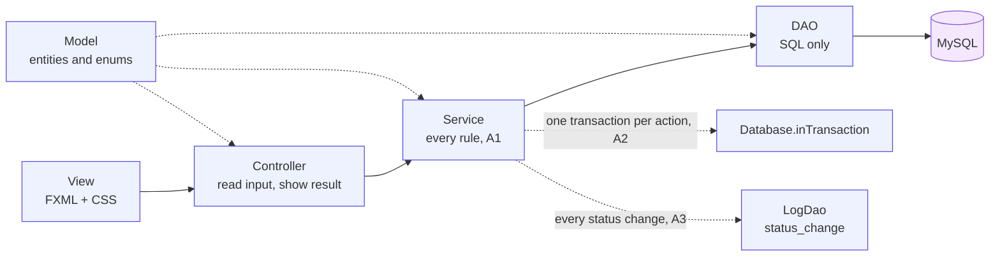

| Layer | Folder | Holds |
|---|---|---|
| View | `view/` | one FXML per screen and one per popup; `aniplato.css` |
| Controller | `controller/` | one class per screen, `shared/dialog/` one per popup |
| Service | `service/` | the rules; the only layer that changes data |
| DAO | `dao/` | SQL only, one per table |
| Model | `model/` | entities, enums, small derived helpers |
| Util | `util/` | config, database, session, navigation, settings |

**Who owns which rule**

| Service | Owns |
|---|---|
| AuthenticationService | login, password rules, forgot password |
| RegistrationService | applying, and the admin's decision |
| DocumentReviewService | verifying documents, the Profile document lists and warnings |
| AccountStatusService | suspend, reinstate, expiry suspension, account list |
| SafetyService | safety notices |
| StatsService | every admin number (derived, never stored, A9) |
| MaintenanceService | the 6.6 checks, in order; calls other services only (A4) |
| EmailService | the four emails and `email_log` |
| FileStorageService | uploads (PDF, JPG, PNG, 5 MB) under `uploads.dir` |

**The popups.** A screen talks only to `DialogController`. It opens one of 16 cards and closes the others. To add a dialog: a card FXML in `view/shared/dialog/`, a `DialogCard` subclass, one `fx:include` in `dialog.fxml`, one `showXxxMode` in `DialogController`. `DialogControllerTest` and `FxmlWiringTest` fail if the wiring is wrong.

## 3. Something broke: which file?

| Symptom | Start at |
|---|---|
| A screen will not open or a button does nothing | its FXML and controller; `FxmlWiringTest` names the mismatch |
| A rule message is wrong or missing | the service method for that action (section 5) |
| The right rule, the wrong data on screen | the DAO method it calls |
| A popup shows wrong text or does not close | its file in `controller/shared/dialog/` and `view/shared/dialog/` |
| An email did not arrive | `service/EmailService.java`, then the `email_log` table (the error is stored) |
| "File is not in the uploads folder" | `uploads.dir` in `db.properties`, `service/FileStorageService.java` |
| An account was suspended by itself | `service/MaintenanceService.java`, `service/AccountStatusService.java` (6.6, reason "Document expired") |
| Login or password trouble | `service/AuthenticationService.java`, `dao/AccountDao.java` |
| Numbers on the admin pages look wrong | `service/StatsService.java`, then `dao/PostDao.java`, `OfferStatsDao.java`, `ReportDao.java` |
| A test cannot connect | `src/test/resources/db.properties`, `support/TestDb.java`, your `db.properties` password |

## 4. Reference A: every file

Paths are relative to `src/main/java/com/aniplato/` unless the heading says otherwise. "Features" uses the IDs from section 1.

### Application and utilities

| File | What it does | Features |
|---|---|---|
| `aniplato/Main.java` | JavaFX entry point: builds the window, starts `Navigator` at the login screen | SHELL |
| `util/AppConfig.java` | reads `db.properties`; a `-Daniplato.<key>` system property overrides it (tests use this) | PLATFORM |
| `util/Database.java` | the only class that opens connections; runs transactions (`inTransaction`) | PLATFORM |
| `util/Selection.java` | the post or offer opened from a list, carried to the next screen | OFFER, HANDOFF, REPORT |
| `util/Session.java` | who is logged in; `requireAdmin` for admin-only services | PLATFORM, AUTH |
| `util/Navigator.java` | the only class that knows view paths: switches screens, sidebar and before-load hooks | SHELL |
| `util/Settings.java` | every setting value (spec 6.7): grace hours, report days, warning days, photos, upload MB, password length, phone digits | PLATFORM |
| `util/PasswordHasher.java` | BCrypt hash and check | AUTH, REVIEW |
| `util/SvgIcon.java` | loads the bundled SVG icons into buttons and badges | SHELL, POPUPS |
| `util/AdminSelection.java` | carries the registration the admin opened from a list to the Review screen | REVIEW |
| `util/RegistrationDraft.java` | holds the registration form between Register, Step 2 and Submitted | REGISTER |
| `exception/RuleViolationException.java` | a broken business rule; its message is shown to the user (A8) | PLATFORM |
| `exception/DataAccessException.java` | wraps an `SQLException`: a bug or an outage, not a rule | PLATFORM |

### Model

| File | What it does | Features |
|---|---|---|
| `model/Account.java` | a login; its role and status; the base of Admin, Donor and FoodGroup | AUTH, ACCOUNTS, PROFILE |
| `model/Admin.java` | the platform admin (no registration) and its profile rows | AUTH, PROFILE |
| `model/Donor.java` | a Business or Casual donor and its profile rows | PROFILE |
| `model/FoodGroup.java` | a food group and its profile rows | PROFILE |
| `model/Registration.java` | an organization's details from sign-up onward | REGISTER, REVIEW |
| `model/DocumentUpload.java` | one file chosen on the registration form with its expiry choice | REGISTER |
| `model/Document.java` | one uploaded file; a renewal is a new row; expiry helpers | REGISTER, REVIEW, PROFILE |
| `model/City.java` | a Metro Manila city; prints as its name for combo boxes | REGISTER |
| `model/SafetyNotice.java` | a safety concern on an offer, with its kind and status | SAFETY |
| `model/Post.java` | a listing or a request with its statuses, deadline and photos | LISTING, REQUEST |
| `model/FoodDetail.java` | what a donor gives: category, storage, allergens, times; the enums for them | LISTING, REQUEST |
| `model/UseDetail.java` | what a food group needs or will do: event, people, place, needed-by | LISTING, REQUEST |
| `model/Report.java` | a food group's report on one handoff; "late" is worked out | REPORT |
| `model/HandoffRecord.java` | the record a completed handoff leaves, worked out when asked and never stored | HANDOFF |
| `model/Offer.java` | an offer on a post: status, kg, its food or use detail, release and receipt times, photos | OFFER, SAFETY, STATS |

### DAOs (SQL only, one per table)

| File | What it does | Features |
|---|---|---|
| `dao/AccountDao.java` | the `account` table: find, insert, suspend, reinstate, passwords | AUTH, REVIEW, ACCOUNTS |
| `dao/RegistrationDao.java` | the `registration` table: insert, queue, decide, counts | REGISTER, REVIEW, STATS |
| `dao/DocumentDao.java` | the `document` table: insert, review, expiry queries | REGISTER, REVIEW, PROFILE, ACCOUNTS, MAINT |
| `dao/CityDao.java` | the `city` table: the registration city list | REGISTER |
| `dao/SafetyNoticeDao.java` | the `safety_notice` table: insert, resolve, admin rows | SAFETY |
| `dao/OfferStatsDao.java` | the `offer` table's counts for the dashboard and report (split from OfferDao to keep both short) | STATS |
| `dao/OfferDao.java` | the `offer` table: send, re-open a withdrawn one, change status only if still in the expected one, an offerer's list, the two parties, the lapse and expiry lookups | OFFER, SAFETY, MAINT |
| `dao/PostDao.java` | the `post` table: insert, the open boards, a poster's own posts, and the dashboard and report totals | LISTING, REQUEST, STATS |
| `dao/DetailDao.java` | the `food_detail` and `use_detail` tables: insert, and read them out of a joined row | LISTING, REQUEST |
| `dao/PhotoDao.java` | the `photo` table: add a photo to a post (offers and reports reuse it), list the paths | LISTING, REQUEST |
| `dao/ReportDao.java` | the `report` table: save and read a report, handoffs with an overdue report, people served, report deadlines | REPORT, STATS |
| `dao/LogDao.java` | `status_change` (every status change, A3) and `email_log` | PLATFORM |

### Services

| File | What it does | Features |
|---|---|---|
| `service/AuthenticationService.java` | login, logout, change and reset password, temporary password | AUTH |
| `service/RegistrationService.java` | check the form, submit, approve, reject, the review queue | REGISTER, REVIEW |
| `service/DocumentReviewService.java` | verify or undo a document, own documents, expiry warnings | REVIEW, PROFILE |
| `service/AccountStatusService.java` | suspend, reinstate, expiry suspension, account list | ACCOUNTS, MAINT, SAFETY |
| `service/SafetyService.java` | raise a concern, list, dismiss, suspend the flagged account | SAFETY |
| `service/StatsService.java` | the dashboard cards and the monthly report | STATS |
| `service/MaintenanceService.java` | runs the 6.6 checks in order, calling other services only | MAINT |
| `service/PostService.java` | create listings and requests, the two boards, a user's own posts | LISTING, REQUEST |
| `service/OfferService.java` | send an offer on either route, withdraw it, the offerer's own list | OFFER |
| `service/HandoffService.java` | confirm release, confirm receipt (completes the offer, rescues the post), build the handoff record | HANDOFF |
| `service/AcceptanceService.java` | the poster's offers list, accept, decline, and the one method that returns a phone number (spec 7.3 puts these in OfferService; split to keep each file under 300 lines) | ACCEPT |
| `service/DetailRules.java` | checks posts and offers share: food detail dates, weight, attestation, text length | LISTING, REQUEST, OFFER |
| `service/ReportService.java` | save a report (once, with photos), read it, work out its due date, prefill the form, flag overdue reports | REPORT |
| `service/EmailService.java` | fills the HTML emails, sends, logs every attempt | AUTH, REGISTER, REVIEW |
| `service/FileStorageService.java` | validates and stores uploads; saves 1 to 5 photos at once; removes files; finds a stored file | REGISTER, PROFILE, REVIEW, LISTING |

### Controllers: screens

| File | What it does | Features |
|---|---|---|
| `controller/LoginController.java` | login form, temporary-password dialog, Forgot password link | AUTH |
| `controller/RegisterController.java` | registration step 1: role, details, city | REGISTER |
| `controller/RegisterStep2Controller.java` | registration step 2: documents, consent, submit | REGISTER |
| `controller/UploadSlot.java` | one document row: file picker, file pill, expiry date | REGISTER, PROFILE |
| `controller/RegisterSubmittedController.java` | the "we received it" screen; clears the draft | REGISTER |
| `controller/ProfileController.java` | own details, documents, expiry banner, password buttons | PROFILE, AUTH |
| `controller/ShellController.java` | header, sidebar, badges, assistant panel, logout, runs the 6.6 checks | SHELL, MAINT |
| `controller/admin/AdminDashboardController.java` | admin cards and the pending list | STATS, REVIEW |
| `controller/admin/PendingRegistrationsController.java` | the review queue | REVIEW |
| `controller/admin/ReviewRegistrationController.java` | one application: documents, verify, approve, reject | REVIEW |
| `controller/admin/AccountsController.java` | all accounts, suspend and reinstate | ACCOUNTS |
| `controller/admin/SafetyNoticesController.java` | the notice list and resolving them | SAFETY |
| `controller/admin/ReportsController.java` | the monthly report | STATS |
| `controller/admin/AdminTable.java` | shared building blocks for the admin tables (cells, pills, dates) | REVIEW, ACCOUNTS, SAFETY |
| `controller/admin/Pager.java` | page arithmetic for the admin lists | REVIEW, ACCOUNTS |
| `controller/donor/DonorDashboardController.java` | donor dashboard (placeholder) | HISTORY |
| `controller/donor/NewListingController.java` | the New Listing form: reads the fields, calls `PostService.createListing` | LISTING |
| `controller/donor/BrowseRequestsController.java` | the donor's board of Open requests | OFFER |
| `controller/donor/MakeOfferController.java` | the donor's offer form for a request | OFFER |
| `controller/donor/IncomingOffersController.java` | offers on a donor's listings: accept, decline | ACCEPT |
| `controller/foodgroup/FoodGroupDashboardController.java` | food group dashboard (placeholder) | HISTORY |
| `controller/foodgroup/BrowseListingsController.java` | the food group's board of Open listings | OFFER |
| `controller/foodgroup/MakeOfferController.java` | the food group's offer form for a listing | OFFER |
| `controller/foodgroup/MyOffersController.java` | the food group's offers, via `MyOfferRows` | OFFER |
| `controller/foodgroup/FoodGroupIncomingOffersController.java` | offers on a food group's requests: accept, decline | ACCEPT |
| `controller/foodgroup/NewRequestController.java` | the New Request form: reads the fields, calls `PostService.createRequest` | REQUEST |
| `controller/foodgroup/MyRequestsController.java` | the food group's requests, via `MyPostRows` | REQUEST, HANDOFF |
| `controller/foodgroup/SubmitReportController.java` | the report form, prefilled | REPORT |
| `controller/shared/MyListingsController.java` | the donor's listings, via `MyPostRows` (asks for "my" posts, no role check) | LISTING, HANDOFF |
| `controller/shared/MyOffersController.java` | the donor's offers, via `MyOfferRows` (asks for "my" offers, no role check) | OFFER |
| `controller/shared/HandoffRecordController.java` | one handoff record with its report; the Submit report button for the receiving group | HANDOFF, REPORT |
| `controller/Cards.java` | small builders for the card rows list screens fill in code | LISTING, OFFER, HANDOFF |
| `controller/PostCards.java` | how a listing, a request and an offer read as cards | LISTING, OFFER |
| `controller/MyPostRows.java` | the rows of My Listings and My Requests: view offers, release, receipt, cancel, record | LISTING, HANDOFF |
| `controller/MyOfferRows.java` | the rows of My Offers: withdraw, offer again, release, receipt, record | OFFER, HANDOFF |
| `controller/IncomingOfferRows.java` | the rows of Incoming Offers: accept, decline, contact | ACCEPT |
| `controller/FormSupport.java` | runs a service call and shows a broken rule; reads numbers; formats dates and kg | LISTING, OFFER, REPORT |
| `controller/DateTimeField.java` | a date picker with a time box, used in the forms | LISTING, OFFER |
| `controller/PhotoPicker.java` | the Add photos button, previews and count | LISTING, OFFER, REPORT |
| `controller/LabelConverter.java` | shows an enum's label in a combo box | LISTING, OFFER |
| `controller/shared/HistoryController.java` | History with sample rows (placeholder) | HISTORY |

### Controllers: popups

| File | What it does | Features |
|---|---|---|
| `controller/shared/DialogController.java` | the one door to every popup: opens one card, closes the rest, `showError` | POPUPS |
| `controller/shared/dialog/DialogCard.java` | what every dialog shares: its card, open, close, confirm | POPUPS |
| `controller/shared/dialog/DialogHost.java` | what a dialog may ask of its overlay | POPUPS |
| `controller/shared/dialog/RejectDialogController.java` | reject an application with a reason | REVIEW |
| `controller/shared/dialog/ApproveDialogController.java` | approve an application | REVIEW |
| `controller/shared/dialog/SuspendAccountDialogController.java` | suspend with a reason | ACCOUNTS |
| `controller/shared/dialog/ReinstateAccountDialogController.java` | reinstate | ACCOUNTS |
| `controller/shared/dialog/ResolveSafetyDialogController.java` | dismiss or suspend from a safety notice | SAFETY |
| `controller/shared/dialog/NoticeResolvedDialogController.java` | shows how a closed notice was resolved | SAFETY |
| `controller/shared/dialog/FlagSafetyDialogController.java` | flag a concern (opens and closes only) | SAFETY |
| `controller/shared/dialog/SetNewPasswordDialogController.java` | replace a temporary password or change a password | AUTH |
| `controller/shared/dialog/ForgotPasswordDialogController.java` | email a temporary password | AUTH |
| `controller/shared/dialog/UploadRenewalDialogController.java` | upload a renewal (opens and closes only) | PROFILE |
| `controller/shared/dialog/UpgradeBusinessDonorDialogController.java` | upgrade to Business donor (opens and closes only) | PROFILE |
| `controller/shared/dialog/CancelListingDialogController.java` | cancel a post (opens and closes only) | HANDOFF |
| `controller/shared/dialog/ConfirmReleaseDialogController.java` | confirm release (opens and closes only) | HANDOFF |
| `controller/shared/dialog/ConfirmReceiptDialogController.java` | confirm receipt (opens and closes only) | HANDOFF |
| `controller/shared/dialog/AcceptOfferDialogController.java` | accept an offer (opens and closes only) | ACCEPT |
| `controller/shared/dialog/WithdrawOfferDialogController.java` | withdraw an offer (opens and closes only) | OFFER |

### Views (`view/`)

| File | What it does | Features |
|---|---|---|
| `view/aniplato.css` | the one stylesheet for every screen and popup | SHELL, POPUPS |
| `view/login.fxml` | login screen | AUTH |
| `view/register.fxml` | registration step 1 | REGISTER |
| `view/register-step2.fxml` | registration step 2 | REGISTER |
| `view/register-submitted.fxml` | registration received | REGISTER |
| `view/profile.fxml` | organization profile | PROFILE |
| `view/shared/shell.fxml` | header, sidebar and content area around every logged-in screen | SHELL |
| `view/shared/dialog.fxml` | the popup overlay that includes the 16 cards | POPUPS |
| `view/shared/handoff-record.fxml` | handoff record | HANDOFF |
| `view/shared/history.fxml` | History | HISTORY |
| `view/shared/my-offers.fxml` | offers screen shared by both donor roles | OFFER |
| `view/admin/dashboard.fxml` | admin dashboard | STATS, REVIEW |
| `view/admin/pending-registrations.fxml` | the review queue | REVIEW |
| `view/admin/review-registration.fxml` | one application | REVIEW |
| `view/admin/accounts.fxml` | all accounts | ACCOUNTS |
| `view/admin/safety-notices.fxml` | safety notices | SAFETY |
| `view/admin/reports.fxml` | monthly report | STATS |
| `view/donor/dashboard.fxml` | donor dashboard | HISTORY |
| `view/donor/new-listing.fxml` | new listing | LISTING |
| `view/donor/my-listings.fxml` | my listings | LISTING |
| `view/donor/browse-request.fxml` | browse requests | OFFER |
| `view/donor/make-offer.fxml` | donor offer form | OFFER |
| `view/donor/incoming-offers.fxml` | offers on my listing | ACCEPT |
| `view/foodgroup/dashboard.fxml` | food group dashboard | HISTORY |
| `view/foodgroup/browse-listings.fxml` | browse listings | OFFER |
| `view/foodgroup/make-offer.fxml` | food group offer form | OFFER |
| `view/foodgroup/my-offers.fxml` | my offers | OFFER |
| `view/foodgroup/incoming-offers.fxml` | offers on my request | ACCEPT |
| `view/foodgroup/new-request.fxml` | new request | REQUEST |
| `view/foodgroup/my-requests.fxml` | my requests | REQUEST |
| `view/foodgroup/submit-report.fxml` | submit report | REPORT |
| `view/shared/dialog/reject.fxml` | Reject card | REVIEW |
| `view/shared/dialog/approve.fxml` | Approve card | REVIEW |
| `view/shared/dialog/suspend-account.fxml` | Suspend card | ACCOUNTS |
| `view/shared/dialog/reinstate-account.fxml` | Reinstate card | ACCOUNTS |
| `view/shared/dialog/resolve-safety.fxml` | Resolve notice card | SAFETY |
| `view/shared/dialog/notice-resolved.fxml` | Notice resolved card | SAFETY |
| `view/shared/dialog/flag-safety.fxml` | Flag concern card | SAFETY |
| `view/shared/dialog/set-new-password.fxml` | Set new password card | AUTH |
| `view/shared/dialog/forgot-password.fxml` | Forgot password card | AUTH |
| `view/shared/dialog/upload-renewal.fxml` | Upload renewal card | PROFILE |
| `view/shared/dialog/upgrade-business-donor.fxml` | Upgrade card | PROFILE |
| `view/shared/dialog/cancel-listing.fxml` | Cancel post card | HANDOFF |
| `view/shared/dialog/confirm-release.fxml` | Confirm release card | HANDOFF |
| `view/shared/dialog/confirm-receipt.fxml` | Confirm receipt card | HANDOFF |
| `view/shared/dialog/accept-offer.fxml` | Accept offer card | ACCEPT |
| `view/shared/dialog/withdraw-offer.fxml` | Withdraw offer card | OFFER |

### Resources, database, scripts and build

| File | What it does | Features |
|---|---|---|
| `resources/db.properties.example` | the config to copy to `db.properties` (database, SMTP, `uploads.dir`) | PLATFORM |
| `email/received.html`, `email/approved.html`, `email/not-approved.html`, `email/forgot-password.html` | the four HTML email templates | REGISTER, REVIEW, AUTH |
| `assets/AcceptedOffers.svg`, `assets/AllAccountsIcon.svg`, `assets/BrowseListings.svg`, `assets/BrowseRequest.svg`, `assets/CIrcle_Check_Button.svg`, `assets/Check_Button.svg`, `assets/Circle_Reject_Button.svg`, `assets/Dashboard Icon.svg`, `assets/HistoryIcon.svg`, `assets/KgRescued.svg`, `assets/MyListingsIcon.svg`, `assets/MyOffers.svg`, `assets/MyRequests.svg`, `assets/NewListingIcon.svg`, `assets/NewRequest.svg`, `assets/OpenListings.svg`, `assets/PendingAccountsIcon.svg`, `assets/ProfileIcon.svg`, `assets/Reject_Button.svg`, `assets/ReportsIcon.svg`, `assets/SafetyNotices.svg` | sidebar, card and badge icons | SHELL, POPUPS |
| `assets/aniplato-logo-circle 1.png`, `assets/login_hero.png` | the logo (window, emails) and the login picture | SHELL, AUTH |
| `sql/schema.sql` | the only copy of the schema; drops and recreates `aniplato` | PLATFORM |
| `sql/seed.sql` | demo data: admin, three organizations, one pending application, a listing and a request | DEMO |
| `sql/seed-admin-demo.sql` | extra demo rows for the admin screens; run once after the seed | DEMO |
| `setup-db.bat`, `setup-db.ps1` | create the database and load the demo data | PLATFORM |
| `scripts/new-methods.sh` | lists the methods a branch adds, for review | TESTS |
| `pom.xml` | Maven build: JavaFX, MySQL, JUnit, copies FXML and CSS to the output | PLATFORM |

### Tests (`src/test/java/com/aniplato/`)

| File | What it proves | Features |
|---|---|---|
| `aniplato/ArchitectureTest.java` | layer rules and the 300-line limit | TESTS |
| `aniplato/MapCoverageTest.java` | this page lists every file and public method | TESTS |
| `service/AuthenticationServiceTest.java` | login, password rules, forgot password | AUTH |
| `service/RegistrationApplyTest.java` | the form, documents, what `submit` saves | REGISTER |
| `service/RegistrationDecisionTest.java` | approve, reject, the queue, rollback | REVIEW |
| `service/DocumentReviewTest.java` | verify, undo, own documents, warnings | REVIEW, PROFILE |
| `service/AccountStatusTest.java` | suspend, reinstate, account list, expiry suspension | ACCOUNTS |
| `service/SafetyServiceTest.java` | raise, dismiss, suspend the flagged side | SAFETY |
| `service/StatsServiceTest.java` | dashboard numbers and the monthly report | STATS |
| `service/PostServiceTest.java` | posting rules, the boards, hidden suspended posters, my posts | LISTING, REQUEST |
| `service/OfferServiceTest.java` | offer rules on both routes, withdraw, re-open, my offers | OFFER |
| `service/HandoffServiceTest.java` | release, receipt, the record, the badge | HANDOFF |
| `service/CancelPostTest.java` | cancel an Open or Accepted post and settle its offers | HANDOFF |
| `service/AcceptanceServiceTest.java` | accept and decline, who sees the offers, who sees a phone number | ACCEPT |
| `service/MaintenanceServiceTest.java` | each of the six checks, and quiet when nothing expired | MAINT |
| `service/ReportServiceTest.java` | the report rules, who sees it, the overdue flag on both routes | REPORT |
| `dao/SafetyNoticeDaoTest.java` | the notice kind is written and read | SAFETY |
| `model/AccountTest.java` | a Suspended account may not post or offer | PROFILE |
| `controller/DialogControllerTest.java` | the real popups: text, one open at a time, Back, callbacks | POPUPS |
| `controller/LoginScreenTest.java` | the Forgot password link opens the dialog with the typed email | AUTH |
| `controller/ScreensTest.java` | the round 3 screens load, show service data, and their buttons call the services | LISTING, OFFER, ACCEPT, HANDOFF, REPORT |
| `controller/ShellMaintenanceTest.java` | the 6.6 checks run before each screen loads | MAINT, SHELL |
| `controller/UploadSlotTest.java` | one upload row shows, restores and reports its file | REGISTER |
| `view/FxmlWiringTest.java` | every handler and `@FXML` field matches its FXML | TESTS |
| `support/DbTest.java` | base class: fresh seeded test database, nobody logged in | TESTS |
| `support/TestDb.java` | builds `aniplato_test` from the schema and seed; refuses any other database | TESTS |
| `support/TestDbTest.java` | the test database loads | TESTS |
| `support/Fixtures.java` | SQL helpers for rows the seed lacks (offers, notices) and sample photo files | TESTS |
| `support/Fx.java` | runs test code on the JavaFX thread | TESTS |
| `resources/db.properties` | test config under src/test/resources: no SMTP keys, so tests never send email | TESTS |

### Docs and project files

| File | What it does | Features |
|---|---|---|
| `docs/Project Spec.md` | the PRD: flows, rules A1-A9, data model; the source of truth | all |
| `docs/MAP.md` | this page | all |
| `docs/FLOWS.md` | build order, conventions C1-C9, one blueprint per unbuilt module | all |
| `docs/CLEANUP-REPORT.md` | what the cleanup changed, results, gaps | TESTS |
| `docs/ARCHITECTURE.md` | the ER diagram | PLATFORM |
| `docs/FXML-GUIDE.md` | how to build a screen in Scene Builder so the Java side can wire it | SHELL |
| `docs/notes/model-report.md` | notes on the model classes | PLATFORM |
| `AGENTS.md` | rules every AI assistant and developer follows | all |
| `CLAUDE.md` | the coding rules summary | all |
| `README.md` | setup and layout | all |
| `LICENSE` | the licence | all |
| `.gitignore`, `.gitattributes` | what git skips; `*.sh` keep Unix line endings | PLATFORM |
| `uploads/.gitkeep` | keeps the git-ignored uploads folder in the repo | PLATFORM |

## 5. Reference B: every feature, its files and methods

Methods are listed as `Class.method`. "Called by" is read from the code; "Test" is the test class that covers it (DAO methods are covered through the service tests).

### AUTH: sign in and passwords ✅

Files: `service/AuthenticationService.java`, `controller/LoginController.java`, `controller/shared/dialog/SetNewPasswordDialogController.java`, `controller/shared/dialog/ForgotPasswordDialogController.java`, `controller/ProfileController.java`, `view/login.fxml`.

| Method | What it does | Called by | Test |
|---|---|---|---|
| `AuthenticationService.login` | checks email and password, starts the session; a Suspended account can log in | LoginController | AuthenticationServiceTest |
| `AuthenticationService.logout` | clears the session | ShellController | AuthenticationServiceTest |
| `AuthenticationService.mustChangePassword` | true while the user has a temporary password | **nobody**: LoginController reads `Account.mustChangePassword` | AuthenticationServiceTest |
| `AuthenticationService.changePassword` | new password: 8+ characters, different, confirmed | SetNewPasswordDialogController | AuthenticationServiceTest |
| `AuthenticationService.requestPasswordReset` | emails a temporary password, replaces the password only after the email is sent | ForgotPasswordDialogController | AuthenticationServiceTest |
| `AuthenticationService.generateTemporaryPassword` | 12 random characters without look-alikes | RegistrationService (approve) | AuthenticationServiceTest |
| `AccountDao.findByEmail` | the account (with its registration) for an email | AuthenticationService, RegistrationService | AuthenticationServiceTest |
| `AccountDao.findPasswordHash` | the stored hash, read only when needed | AuthenticationService | AuthenticationServiceTest |
| `AccountDao.updatePassword` | saves a new hash and clears the temporary flag | AuthenticationService | AuthenticationServiceTest |
| `AccountDao.setTemporaryPassword` | stores a temporary hash and sets the flag | AuthenticationService | AuthenticationServiceTest |
| `PasswordHasher.hash` | BCrypt hash | AuthenticationService, RegistrationService | AuthenticationServiceTest |
| `PasswordHasher.matches` | BCrypt check | AuthenticationService | AuthenticationServiceTest |
| `EmailService.sendPasswordReset` | the reset email | AuthenticationService | AuthenticationServiceTest (send fails, is logged) |

**Flow**

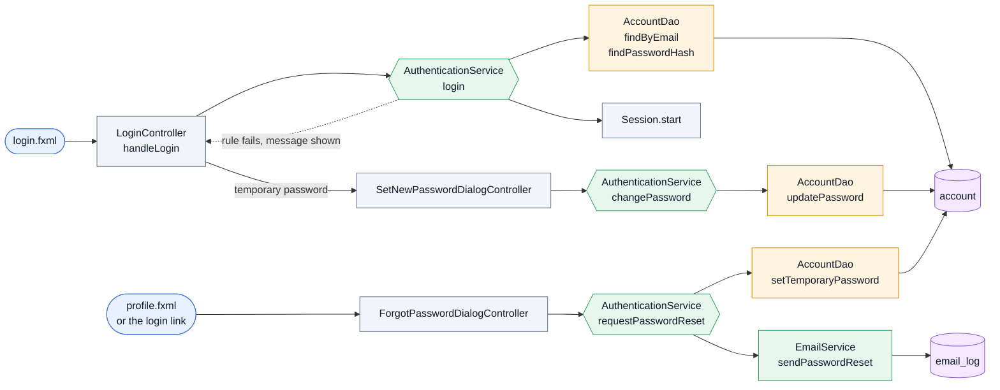

### REGISTER: apply for an account ✅

Files: `service/RegistrationService.java`, `controller/RegisterController.java`, `controller/RegisterStep2Controller.java`, `controller/UploadSlot.java`, `controller/RegisterSubmittedController.java`, `util/RegistrationDraft.java`, `model/DocumentUpload.java`, `view/register.fxml`, `view/register-step2.fxml`, `view/register-submitted.fxml`, `email/received.html`.

| Method | What it does | Called by | Test |
|---|---|---|---|
| `RegistrationService.cities` | the city list for the form | RegisterController | RegistrationApplyTest |
| `RegistrationService.checkDetails` | every detail present, role chosen, 11-digit phone, valid email, email not already an account | RegisterController | RegistrationApplyTest |
| `RegistrationService.submit` | checks the documents, saves registration, files, documents and log in one transaction, then sends the Received email | RegisterStep2Controller | RegistrationApplyTest |
| `CityDao.findAll` | all cities by name | RegistrationService | RegistrationApplyTest |
| `AccountDao.existsByEmail` | true if a login already uses the email | RegistrationService | RegistrationApplyTest |
| `RegistrationDao.insert` | saves a Pending registration | RegistrationService | RegistrationApplyTest |
| `DocumentDao.insert` | saves an uploaded file awaiting review | RegistrationService | RegistrationApplyTest |
| `FileStorageService.validate` | PDF, JPG or PNG, at most 5 MB | RegistrationService, UploadSlot | RegistrationApplyTest |
| `FileStorageService.save` | copies the file to `uploads.dir` under a random name | RegistrationService | RegistrationApplyTest |
| `FileStorageService.resolve` | the stored file for a saved path | ProfileController, ReviewRegistrationController | RegistrationApplyTest |
| `EmailService.sendReceived` | the "we received your registration" email | RegistrationService | RegistrationApplyTest |
| `RegistrationDraft.get` | the form kept between steps | RegisterController, RegisterStep2Controller, RegisterSubmittedController | none (UI state) |
| `RegistrationDraft.set` | keeps the step 1 form | RegisterController | none |
| `RegistrationDraft.uploads` | the files chosen on step 2, kept while going Back | RegisterStep2Controller | UploadSlotTest |
| `RegistrationDraft.setUploads` | remembers them on Back | RegisterStep2Controller | none |
| `RegistrationDraft.clear` | forgets the draft once submitted | RegisterSubmittedController | none |

**Flow**

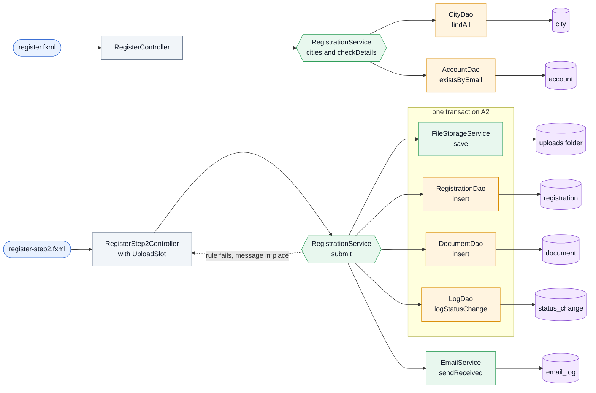

### REVIEW: the admin reviews applications ✅

Files: `service/RegistrationService.java`, `service/DocumentReviewService.java`, `controller/admin/PendingRegistrationsController.java`, `controller/admin/ReviewRegistrationController.java`, `controller/admin/AdminTable.java`, `controller/admin/Pager.java`, `controller/shared/dialog/ApproveDialogController.java`, `controller/shared/dialog/RejectDialogController.java`, `util/AdminSelection.java`, `view/admin/pending-registrations.fxml`, `view/admin/review-registration.fxml`, `email/approved.html`, `email/not-approved.html`.

| Method | What it does | Called by | Test |
|---|---|---|---|
| `RegistrationService.getPending` | Pending applications, oldest first, marked "registered again" | PendingRegistrationsController, AdminDashboardController | RegistrationDecisionTest |
| `RegistrationService.getForReview` | one application with all its documents | ReviewRegistrationController | RegistrationDecisionTest |
| `RegistrationService.approve` | every document verified, unexpired, unflagged; creates the account (or moves an upgrade); one transaction; then the Approved email | ApproveDialogController | RegistrationDecisionTest |
| `RegistrationService.reject` | needs a reason (500 max); stores it; no account; then the Not approved email | RejectDialogController | RegistrationDecisionTest |
| `DocumentReviewService.verifyDocument` | admin marks a document OK | ReviewRegistrationController | DocumentReviewTest |
| `DocumentReviewService.undoVerification` | takes the verification back | ReviewRegistrationController | DocumentReviewTest |
| `RegistrationDao.findByStatus` | applications in one status, oldest first | RegistrationService | RegistrationDecisionTest |
| `RegistrationDao.findById` | one application with its city | RegistrationService | RegistrationDecisionTest |
| `RegistrationDao.countEarlierRejected` | earlier rejections for the same email | RegistrationService | RegistrationDecisionTest |
| `RegistrationDao.approve` | Pending to Approved, with the reviewer | RegistrationService | RegistrationDecisionTest |
| `RegistrationDao.reject` | Pending to Rejected, with reason and reviewer | RegistrationService | RegistrationDecisionTest |
| `DocumentDao.findByRegistration` | every file of a registration, oldest first | RegistrationService, DocumentReviewService | RegistrationDecisionTest |
| `DocumentDao.findById` | one document | DocumentReviewService | DocumentReviewTest |
| `DocumentDao.markOk` | Awaiting to OK (approve step) | RegistrationService | RegistrationDecisionTest |
| `DocumentDao.markReviewed` | the admin's verdict: OK, FLAGGED with a reason, or back to awaiting | DocumentReviewService | DocumentReviewTest |
| `AccountDao.insert` | creates the login of an approved registration | RegistrationService | RegistrationDecisionTest |
| `AccountDao.moveToRegistration` | an approved upgrade: same account, new registration and role | RegistrationService | RegistrationDecisionTest |
| `EmailService.sendApproved` | the temporary login email | RegistrationService | RegistrationDecisionTest |
| `EmailService.sendNotApproved` | the rejection reasons email | RegistrationService | RegistrationDecisionTest |
| `AdminSelection.selectRegistration` | remembers the application the admin opened | PendingRegistrationsController, AdminDashboardController | none (UI state) |
| `AdminSelection.registrationId` | reads it on the Review screen | ReviewRegistrationController | none |

**Flow**

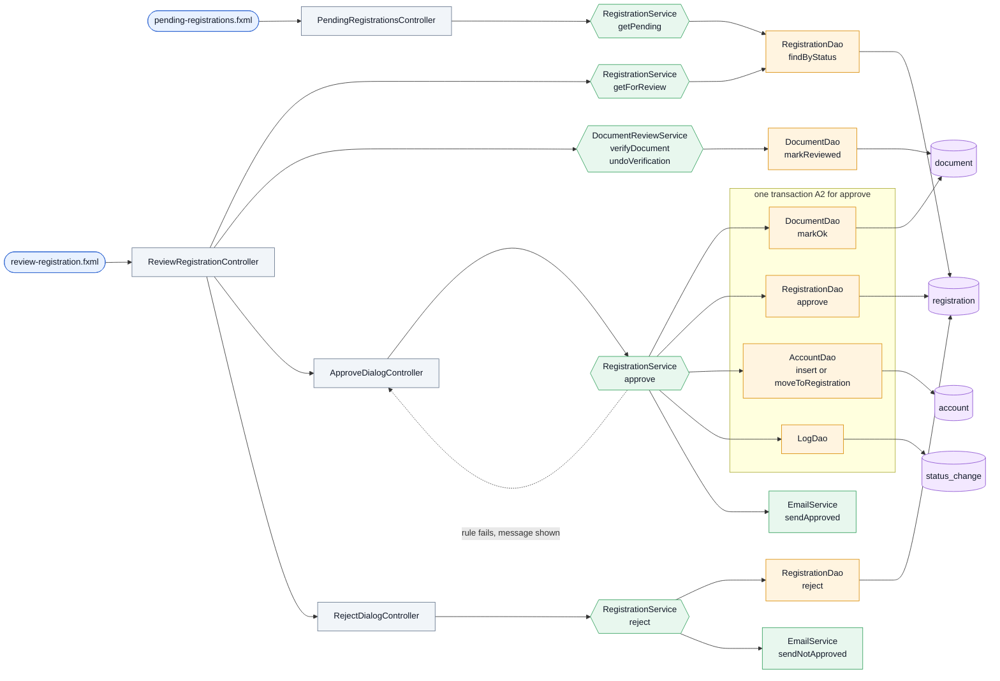

### ACCOUNTS: the admin manages accounts ✅

Files: `service/AccountStatusService.java`, `controller/admin/AccountsController.java`, `controller/shared/dialog/SuspendAccountDialogController.java`, `controller/shared/dialog/ReinstateAccountDialogController.java`, `view/admin/accounts.fxml`.

| Method | What it does | Called by | Test |
|---|---|---|---|
| `AccountStatusService.getAccounts` | every organization with its next ending document; counts worked out from the rows | AccountsController | AccountStatusTest |
| `AccountStatusService.suspendAccount` | admin suspends an Active account with a reason | AccountsController | AccountStatusTest |
| `AccountStatusService.reinstateAccount` | admin gives a Suspended account its access back | AccountsController | AccountStatusTest |
| `AccountStatusService.suspend` | the suspension itself, inside someone else's transaction | SafetyService | SafetyServiceTest |
| `AccountDao.findAllOrganizations` | donors and food groups by name, with their registration | AccountStatusService | AccountStatusTest |
| `AccountDao.suspendIfActive` | Active to Suspended; 0 rows if it was not Active | AccountStatusService | AccountStatusTest |
| `AccountDao.reinstateIfSuspended` | Suspended to Active; 0 rows if it was not Suspended | AccountStatusService | AccountStatusTest |
| `DocumentDao.findEndingBy` | verified documents in force that end by a date | AccountStatusService, StatsService | AccountStatusTest |

**Flow**

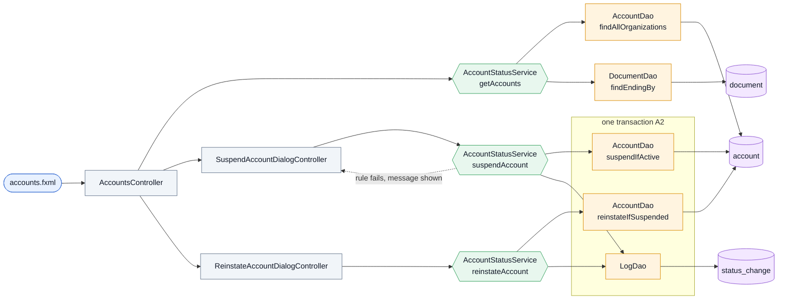

### PROFILE: the organization's own profile 🟡

Files: `controller/ProfileController.java`, `view/profile.fxml`, `controller/shared/dialog/UploadRenewalDialogController.java` and `controller/shared/dialog/UpgradeBusinessDonorDialogController.java` (placeholders), `model/Admin.java`, `model/Donor.java`, `model/FoodGroup.java`.

| Method | What it does | Called by | Test |
|---|---|---|---|
| `DocumentReviewService.getMyDocuments` | the latest upload of each document type | ProfileController | DocumentReviewTest |
| `DocumentReviewService.getCurrentDocumentAlerts` | verified documents expired or ending within 30 days | ProfileController | DocumentReviewTest |
| `DocumentDao.findCurrentAlerts` | the query behind the warning banner | DocumentReviewService | DocumentReviewTest |

**Flow** (dashed = not built yet)

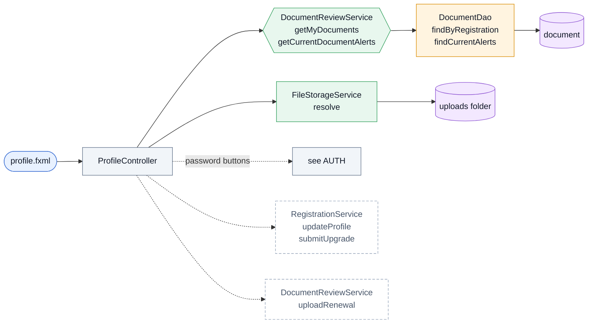

### SAFETY: safety notices 🟡

Files: `service/SafetyService.java`, `dao/SafetyNoticeDao.java`, `model/SafetyNotice.java`, `controller/admin/SafetyNoticesController.java`, `controller/shared/dialog/ResolveSafetyDialogController.java`, `controller/shared/dialog/NoticeResolvedDialogController.java`, `controller/shared/dialog/FlagSafetyDialogController.java` (placeholder), `view/admin/safety-notices.fxml`.

| Method | What it does | Called by | Test |
|---|---|---|---|
| `SafetyService.raise` | either side of an Accepted or Completed offer flags a concern about the other | **no screen yet** | SafetyServiceTest |
| `SafetyService.raiseOverdueReport` | the system flags a food group that owes a report (a notice with no raiser), once per handoff | ReportService | ReportServiceTest |
| `OfferDao.isOnListing` | is the offer on a listing or a request (tells who the food group is) | SafetyService | ReportServiceTest |
| `SafetyService.getNoticeRows` | every notice with both organization names, newest first | SafetyNoticesController | SafetyServiceTest |
| `SafetyService.dismiss` | admin closes a notice with a note | SafetyNoticesController | SafetyServiceTest |
| `SafetyService.suspendFlaggedAccount` | admin suspends the other side and closes the notice; one transaction | SafetyNoticesController | SafetyServiceTest |
| `SafetyNoticeDao.insert` | saves a notice with its kind | SafetyService | SafetyNoticeDaoTest |
| `SafetyNoticeDao.findById` | one notice | SafetyService | SafetyNoticeDaoTest |
| `SafetyNoticeDao.resolve` | Open to Dismissed or Account suspended, with note and admin | SafetyService | SafetyServiceTest |
| `SafetyNoticeDao.findRows` | notices joined with the organization names | SafetyService | SafetyServiceTest |
| `SafetyNoticeDao.countOpen` | open notices, for the dashboard | StatsService | StatsServiceTest |
| `OfferDao.findParties` | who made an offer and who posted what it is on | SafetyService | SafetyServiceTest |
| `OfferDao.findStatus` | an offer's status | SafetyService | SafetyServiceTest |

**Flow** (dashed = not built yet)

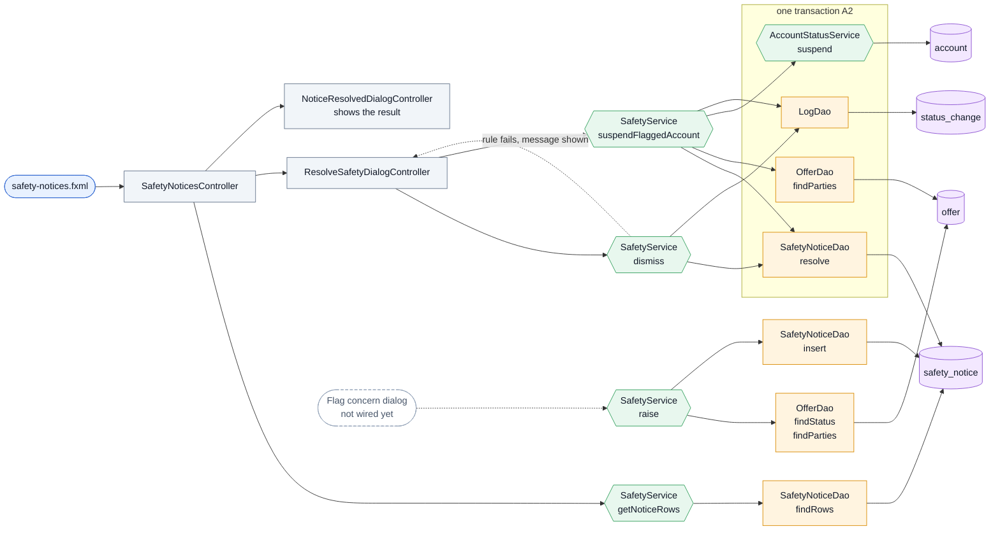

### STATS: admin numbers ✅

Files: `service/StatsService.java`, `controller/admin/AdminDashboardController.java`, `controller/admin/ReportsController.java`, `view/admin/dashboard.fxml`, `view/admin/reports.fxml`, the badges in `controller/ShellController.java`.

| Method | What it does | Called by | Test |
|---|---|---|---|
| `StatsService.getAdminSummary` | the six dashboard cards for the current month | AdminDashboardController, ShellController | StatsServiceTest |
| `StatsService.getReportMonths` | months with posts, the current month always first | ReportsController | StatsServiceTest |
| `StatsService.getReport` | every Section 3 metric for one month and the By City rows | ReportsController | StatsServiceTest |
| `PostDao.totalsByCity` | kg posted, rescued, expired and closed per city | StatsService | StatsServiceTest |
| `PostDao.sumKgListed` | kg on listings created in a period | StatsService | StatsServiceTest |
| `PostDao.countWithOffers` | posts that got at least one offer | StatsService | StatsServiceTest |
| `PostDao.countWithAcceptedOffer` | posts that had an offer accepted | StatsService | StatsServiceTest |
| `PostDao.findMonthsWithPosts` | every month that has a post | StatsService | StatsServiceTest |
| `OfferStatsDao.countCompleted` | completed handoffs in a period | StatsService | StatsServiceTest |
| `OfferStatsDao.countAccepted` | offers ever accepted in a period | StatsService | StatsServiceTest |
| `OfferStatsDao.countLapsed` | offers that lapsed in a period | StatsService | StatsServiceTest |
| `ReportDao.sumPeopleServed` | people served in reports of a period | StatsService | StatsServiceTest |
| `ReportDao.countHandoffsPastDeadline` | handoffs whose report was due | StatsService | StatsServiceTest |
| `ReportDao.countReportedOnTime` | those reported on time | StatsService | StatsServiceTest |
| `RegistrationDao.countByStatus` | applications in one status | StatsService | StatsServiceTest |
| `AccountDao.countSuspended` | suspended accounts | StatsService | StatsServiceTest |

**Flow**

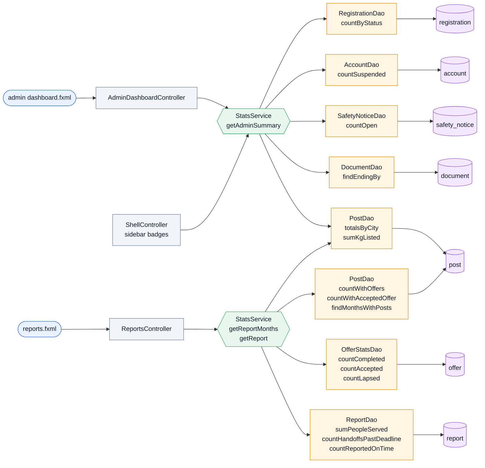

### MAINT: automatic checks 🟡

Files: `service/MaintenanceService.java`, `controller/ShellController.java`, `util/Navigator.java`.

| Method | What it does | Called by | Test |
|---|---|---|---|
| `MaintenanceService.runMaintenance` | runs the six 6.6 checks in order, calling the owning services | ShellController | MaintenanceServiceTest, ShellMaintenanceTest |
| `HandoffService.lapseMissedPickups` | 1: an Accepted offer 2 hours past its pickup with no release becomes Lapsed, its post Expired | MaintenanceService | MaintenanceServiceTest |
| `PostService.expireOpenPosts` | 2 and 3: an Open listing past its use-by, or an Open request past its needed-by, expires with its Offered offers | MaintenanceService | MaintenanceServiceTest |
| `OfferService.expireUnansweredOffers` | 4: an Offered offer past its pickup time or window end expires | MaintenanceService | MaintenanceServiceTest |
| `ReportService.flagOverdueReports` | 5: a Completed handoff with no report 7 days after receipt is flagged to the admin once | MaintenanceService | MaintenanceServiceTest, ReportServiceTest |
| `OfferDao.findMissedPickups` | Accepted, unreleased offers past the lapse cutoff | HandoffService | MaintenanceServiceTest |
| `OfferDao.findUnansweredPastPickup` | Offered offers past their pickup | OfferService | MaintenanceServiceTest |
| `PostDao.findOpenPastDeadline` | Open posts of one kind past their deadline | PostService | MaintenanceServiceTest |
| `ReportDao.findOverdueWithoutFlag` | Completed handoffs past the report deadline with no report and no flag yet | ReportService | ReportServiceTest |
| `AccountStatusService.suspendAccountsWithExpiredDocuments` | an Active account with a current verified expired document becomes Suspended ("Document expired") | MaintenanceService | AccountStatusTest, MaintenanceServiceTest |
| `DocumentDao.findCurrentExpiredRegistrations` | the accounts that query finds | AccountStatusService | AccountStatusTest |
| `Navigator.setBeforeScreenListener` | lets the shell run something before each in-shell screen loads | ShellController | ShellMaintenanceTest |

**Flow** (the six checks run in this order)

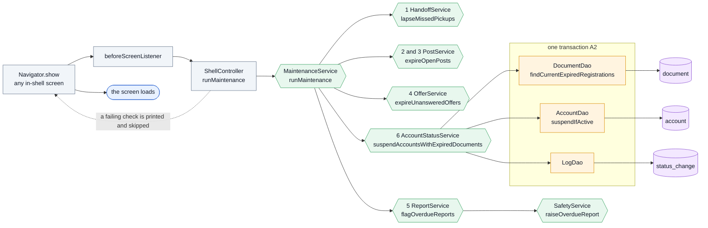

### LISTING and REQUEST: post food, browse the other side's board 🟡

Files: `service/PostService.java`, `dao/PostDao.java`, `dao/DetailDao.java`, `dao/PhotoDao.java`, `model/Post.java`, `model/FoodDetail.java`, `model/UseDetail.java`, `service/FileStorageService.java`. The screens wire them through `Cards`, `PostCards` and `FormSupport`.

| Method | What it does | Called by | Test |
|---|---|---|---|
| `PostService.createListing` | a donor posts a listing: checks the rules, saves photos, then food detail, post and log in one transaction | NewListingController | PostServiceTest |
| `PostService.createRequest` | a food group posts a request, the same way | NewRequestController | PostServiceTest |
| `PostService.getOpenListings` | Open listings for a food group, its city first, suspended donors hidden, no handover text | BrowseListingsController, foodgroup MakeOfferController | PostServiceTest |
| `PostService.getOpenRequests` | Open requests for a donor; a Casual donor sees only raw or packaged | BrowseRequestsController, donor MakeOfferController | PostServiceTest |
| `PostService.getMyPosts` | the logged-in account's own posts with offer counts | MyPostRows | PostServiceTest |
| `PostDao.insert` | saves the post row for an inserted detail | PostService | PostServiceTest |
| `PostDao.findById` | one post with its detail | OfferService | OfferServiceTest |
| `PostDao.findOpenForUpdate` | an Open post from an Active poster, locked until the transaction ends | OfferService | OfferServiceTest |
| `PostDao.findOpenBoard` | Open posts of one kind from Active posters, viewer's city first | PostService | PostServiceTest |
| `PostDao.findByPoster` | one account's posts with their offer counts | PostService | PostServiceTest |
| `DetailDao.insertFood` | saves a food detail | PostService | PostServiceTest |
| `DetailDao.insertUse` | saves a use detail | PostService | PostServiceTest |
| `DetailDao.readFood` | reads the food columns of a joined row | PostDao | PostServiceTest |
| `DetailDao.readUse` | reads the use columns of a joined row | PostDao | PostServiceTest |
| `PhotoDao.insert` | attaches a stored photo path to a post (offers and reports reuse it) | PostService | PostServiceTest |
| `PhotoDao.findPaths` | the photo paths of one post | PostService | PostServiceTest |
| `FileStorageService.saveAllPhotos` | checks 1 to 5 files, then saves them; removes any it already copied if one fails | PostService | PostServiceTest |
| `FileStorageService.deleteAll` | removes saved files after a failed transaction | PostService | PostServiceTest |

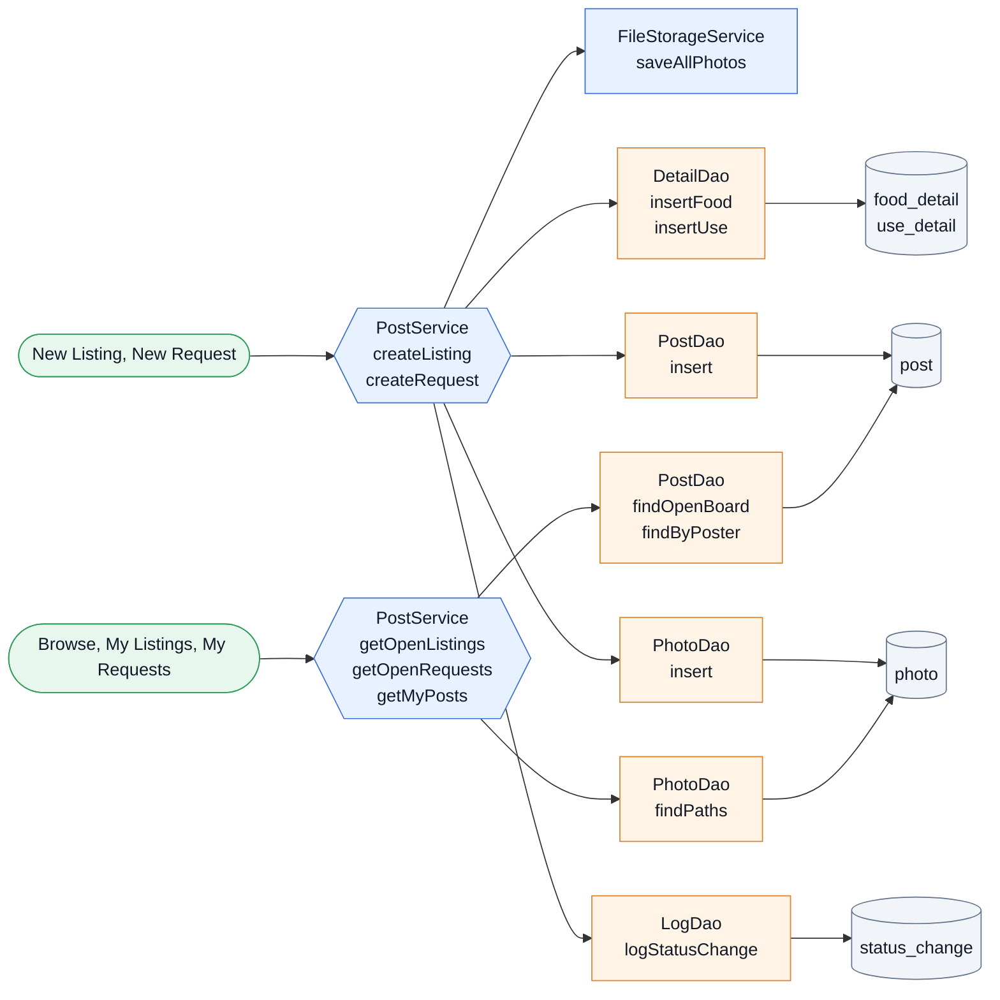

### OFFER: send and withdraw offers 🟡

Files: `service/OfferService.java`, `service/DetailRules.java`, `dao/OfferDao.java`, `dao/DetailDao.java`, `dao/PhotoDao.java`, `model/Offer.java`. Screens: the two Make Offer forms, the browse boards and the My Offers lists (`MyOfferRows`).

| Method | What it does | Called by | Test |
|---|---|---|---|
| `OfferService.sendListingOffer` | a food group offers for a listing's whole quantity; re-opens its Withdrawn offer on the same row | foodgroup MakeOfferController | OfferServiceTest |
| `OfferService.sendRequestOffer` | a donor offers on a request: kg up to the requested amount, a category the request accepts | donor MakeOfferController | OfferServiceTest |
| `OfferService.withdraw` | the offerer takes back an Offered offer, logged | MyOfferRows | OfferServiceTest |
| `OfferService.getMyOffers` | the logged-in account's offers with the post, photos and handover text only once accepted | MyOfferRows screens, the browse boards | OfferServiceTest |
| `OfferDao.insert` | saves a new offer | OfferService | OfferServiceTest |
| `OfferDao.reopenIfWithdrawn` | puts a Withdrawn offer back to Offered with new details | OfferService | OfferServiceTest |
| `OfferDao.updateStatusIf` | changes the status only if it is still the expected one | OfferService | OfferServiceTest |
| `OfferDao.findById` | one offer with its detail | OfferService | OfferServiceTest |
| `OfferDao.findByPostAndOfferer` | the offer one account made on a post, in any status | OfferService | OfferServiceTest |
| `OfferDao.findByOfferer` | every offer one account made | OfferService | OfferServiceTest |
| `Selection.selectPost` | remembers the post opened from a board or list | BrowseListingsController, BrowseRequestsController, MyOfferRows | ScreensTest |
| `Selection.postId` | the post the Make Offer form is for | both MakeOfferControllers | ScreensTest |
| `Selection.selectOffer` | remembers the offer opened from a list | MyPostRows, MyOfferRows, HandoffRecordController | ScreensTest |
| `Selection.offerId` | the offer the record and report screens are for | HandoffRecordController, SubmitReportController | ScreensTest |
| `DetailDao.deleteFood` | removes the food detail an offer no longer uses | OfferService | OfferServiceTest |
| `DetailDao.deleteUse` | removes the use detail an offer no longer uses | OfferService | OfferServiceTest |
| `PhotoDao.deleteFor` | removes the photo rows of an offer being re-opened | OfferService | OfferServiceTest |

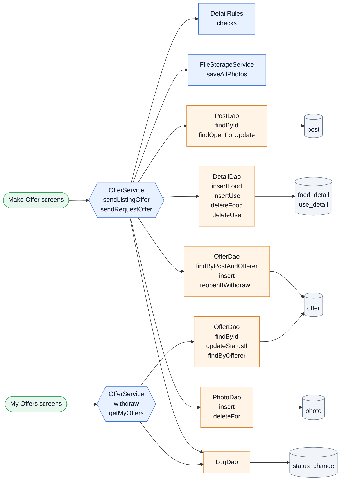

### ACCEPT: the poster decides 🟡

Files: `service/AcceptanceService.java`, `service/PostService.java` (the status door), `dao/OfferDao.java`, `dao/PostDao.java`, `dao/AccountDao.java`. Screens: the two incoming-offers lists (`IncomingOfferRows`).

| Method | What it does | Called by | Test |
|---|---|---|---|
| `AcceptanceService.getIncomingOffers` | offers on the logged-in poster's posts, without Withdrawn ones or Offered ones from a Suspended offerer | both incoming-offers controllers | AcceptanceServiceTest |
| `AcceptanceService.countOffersAwaitingDecision` | Offered offers waiting for the poster: the donor's sidebar badge | **no screen yet**: the sidebar badge is not wired | AcceptanceServiceTest |
| `AcceptanceService.accept` | one transaction: this offer Accepted, the others Declined, the post Accepted, all logged | IncomingOfferRows | AcceptanceServiceTest |
| `AcceptanceService.decline` | the poster declines one Offered offer | IncomingOfferRows | AcceptanceServiceTest |
| `AcceptanceService.getContactPhone` | the only method that returns a phone number: the owner, an admin, or the other side of an Accepted offer (A7) | MyPostRows, MyOfferRows, IncomingOfferRows | AcceptanceServiceTest |
| `PostService.changeStatus` | the one door for a post's status change, with the log (A3) | AcceptanceService | AcceptanceServiceTest |
| `PostDao.findForUpdate` | a post in any status, locked until the transaction ends | AcceptanceService | AcceptanceServiceTest |
| `PostDao.updateStatusIf` | changes a post's status only if it is still the expected one | PostService | AcceptanceServiceTest |
| `OfferDao.findIncoming` | the offers on one poster's posts | AcceptanceService | AcceptanceServiceTest |
| `OfferDao.findOfferedIdsExcept` | the other Offered offers on a post, which an accept declines | AcceptanceService | AcceptanceServiceTest |
| `OfferDao.countAwaitingDecision` | Offered offers from Active offerers on a poster's Open posts | AcceptanceService | AcceptanceServiceTest |
| `AccountDao.findContactPhone` | an account's number; only AcceptanceService.getContactPhone calls it | AcceptanceService | AcceptanceServiceTest |

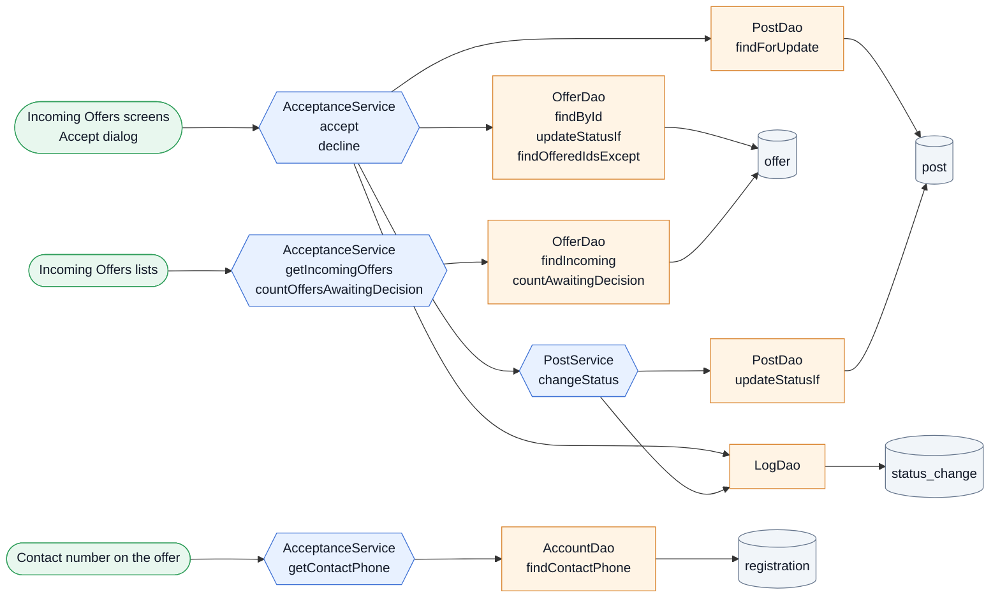

### HANDOFF: release, receipt, record, cancel 🟡

Files: `service/HandoffService.java`, `service/PostService.java` (cancel), `dao/OfferDao.java`, `model/HandoffRecord.java`. Screens: the dialogs open from `MyPostRows` and `MyOfferRows`; the record screen is `HandoffRecordController`.

| Method | What it does | Called by | Test |
|---|---|---|---|
| `HandoffService.confirmRelease` | the donor confirms the handover on an Accepted offer, once | MyPostRows, MyOfferRows | HandoffServiceTest |
| `HandoffService.confirmReceipt` | the food group confirms receipt after release: offer Completed, post Rescued, one transaction, logged | MyPostRows, MyOfferRows | HandoffServiceTest |
| `HandoffService.getHandoffRecord` | the record of a Completed offer for its two sides or an admin: number, names, food, kg, times, use, report due date | HandoffRecordController | HandoffServiceTest |
| `HandoffService.countAwaitingHandoff` | Accepted offers an account is waiting on: the food group's sidebar badge | **no screen yet**: the sidebar badge is not wired | HandoffServiceTest |
| `PostService.cancelPost` | the poster cancels an Open or Accepted post with a reason; waiting offers Declined, the accepted one Cancelled; blocked after release | MyPostRows | CancelPostTest |
| `OfferDao.markReleasedIf` | sets the release time on an Accepted offer, once | HandoffService | HandoffServiceTest |
| `OfferDao.completeIfReleased` | Accepted to Completed with the receipt time, only after release | HandoffService | HandoffServiceTest |
| `OfferDao.findIdsByStatus` | a post's offers in one status | PostService | CancelPostTest |
| `OfferDao.countAcceptedFor` | Accepted offers an account is a side of | HandoffService | HandoffServiceTest |

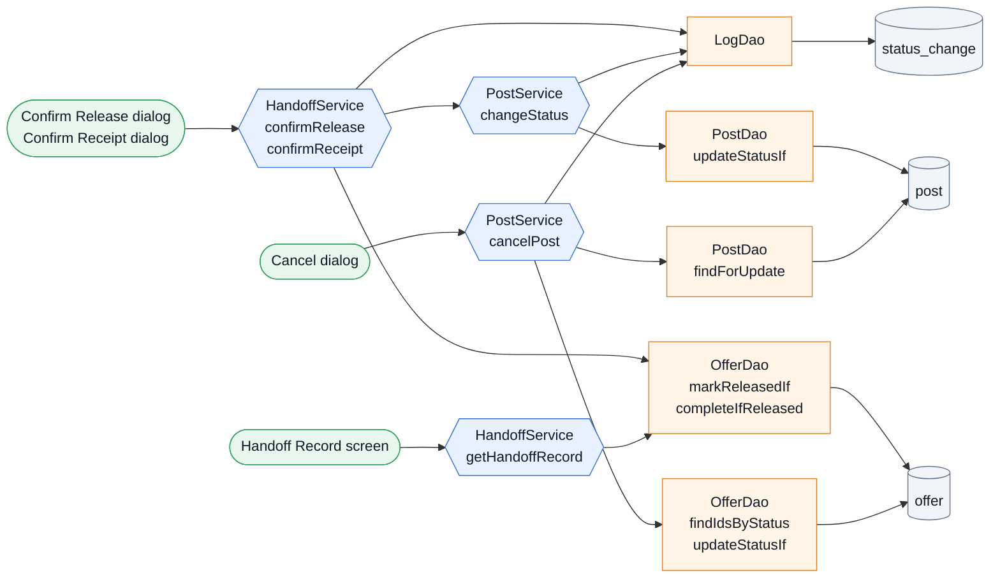

### REPORT: the food group's documentation report 🟡

Files: `service/ReportService.java`, `dao/ReportDao.java`, `model/Report.java`, `service/SafetyService.java` (the overdue flag). Screens: `SubmitReportController` and the report block of `HandoffRecordController`.

| Method | What it does | Called by | Test |
|---|---|---|---|
| `ReportService.submitReport` | the receiving food group submits the report once for a Completed handoff, with 1 to 5 photos and the consent; late is accepted | SubmitReportController | ReportServiceTest |
| `ReportService.getReport` | the report for the two sides or an admin, read-only, or nothing yet | HandoffRecordController | ReportServiceTest |
| `ReportService.getDueAt` | receipt plus 7 days, worked out | SubmitReportController | ReportServiceTest |
| `ReportService.getDefaults` | the event name and date the form starts with | SubmitReportController | ReportServiceTest |
| `ReportDao.insert` | saves a report | ReportService | ReportServiceTest |
| `ReportDao.findByOffer` | the report of one handoff | ReportService | ReportServiceTest |
| `Report.isLate` | submitted after the deadline | HandoffRecordController | ReportServiceTest |
| `ReportService.canSubmit` | is this account the receiving group with no report yet: shows the Submit report button | HandoffRecordController | ScreensTest |

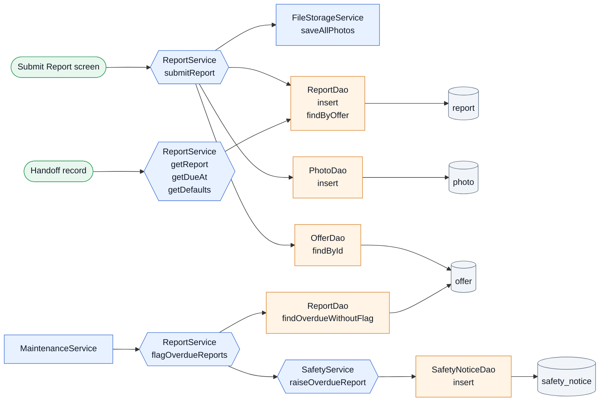

### SHELL: the app frame 🔧

Files: `controller/ShellController.java`, `view/shared/shell.fxml`, `util/Navigator.java`, `util/SvgIcon.java`, `view/aniplato.css`, `aniplato/Main.java`.

**Flow**

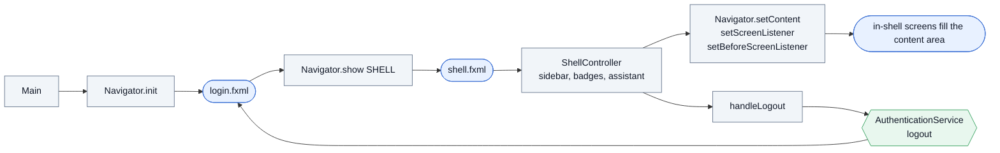

| Method | What it does | Called by | Test |
|---|---|---|---|
| `Navigator.init` | gives Navigator the window's scene and wires every `nav-*` button | Main | ShellMaintenanceTest |
| `Navigator.show` | shows a screen: a window screen replaces the scene, an in-shell one fills the content area | most controllers | ShellMaintenanceTest |
| `Navigator.setContent` | tells Navigator where in-shell screens go | ShellController | ShellMaintenanceTest |
| `Navigator.setScreenListener` | lets the sidebar refresh its highlight after each navigation | ShellController | none |
| `Navigator.sidebarScreenFor` | which sidebar button a detail screen highlights | ShellController | none |
| `Navigator.currentRole` | the logged-in role | MyOffersController, HistoryController, HandoffRecordController | none |
| `Navigator.currentScreen` | the screen being shown | ShellController | none |
| `Navigator.key` | the `nav-<key>` name of a screen | Navigator | none |
| `SvgIcon.load` | loads an SVG icon as a node | DialogController, ShellController, ReviewRegistrationController | DialogControllerTest |

### POPUPS: dialogs 🔧

Files: `controller/shared/DialogController.java`, `controller/shared/dialog/` (all), `view/shared/dialog.fxml`, `view/shared/dialog/` (all). Sixteen dialogs; eight do a real action (Reject, Approve, Suspend, Reinstate, Resolve notice, Notice resolved, Set new password, Forgot password) and eight only open and close until their feature is built.

**Flow**

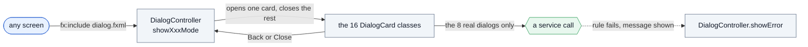

The `showXxxMode` methods are in `DialogController` and are outside the service/DAO coverage rule; section 6 lists the ones nothing calls yet. Test: `DialogControllerTest`.

### PLATFORM: foundations 🔧

Files: `util/AppConfig.java`, `util/Database.java`, `util/Session.java`, `util/Settings.java`, `util/PasswordHasher.java`, `service/EmailService.java`, `service/FileStorageService.java`, `dao/LogDao.java`, `exception/` (both), `sql/` (all), `pom.xml`.

**Flow**

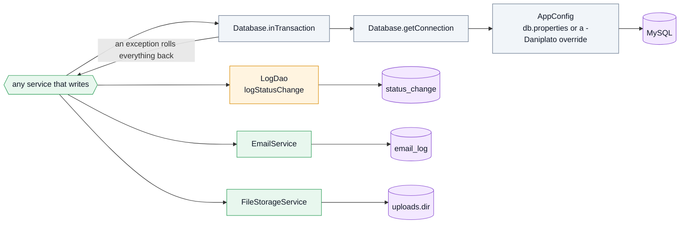

| Method | What it does | Called by | Test |
|---|---|---|---|
| `AppConfig.get` | a setting from `db.properties` (or a `-Daniplato.<key>` override), with a fallback | FileStorageService | TestDbTest |
| `AppConfig.required` | the same, but a missing value is a setup mistake | Database | TestDbTest |
| `Database.getConnection` | opens a connection | every service | every service test |
| `Database.inTransaction` | all-or-nothing: commit if the work finishes, roll back if anything throws (A2) | RegistrationService, AccountStatusService, DocumentReviewService, SafetyService | RegistrationDecisionTest (rollback) |
| `Session.start` | begins a session | AuthenticationService | AuthenticationServiceTest |
| `Session.clear` | ends it | AuthenticationService | AuthenticationServiceTest |
| `Session.isLoggedIn` | is anyone logged in | AuthenticationService | AuthenticationServiceTest |
| `Session.current` | the logged-in account or null | AuthenticationService, DocumentReviewService | DocumentReviewTest |
| `Session.require` | the logged-in account; nobody logged in is a bug | services, ProfileController, ShellController | every service test |
| `Session.requireAdmin` | the logged-in admin; anyone else is refused with a message | admin-only services | AccountStatusTest |
| `LogDao.logStatusChange` | one row in `status_change` for every status change (A3) | RegistrationService, DocumentReviewService, AccountStatusService, SafetyService | every decision test |
| `LogDao.logEmail` | one row in `email_log` per send attempt, with the error if it failed | EmailService | AuthenticationServiceTest |

### Model helpers

| Method | What it does | Called by | Test |
|---|---|---|---|
| `Account.displayName` | the role's name on screen (on the role enum) and the abstract name shown in headers | ShellController, ProfileController | none |
| `Account.key` | the role's `role-<key>` style class for the sidebar | ShellController | none |
| `Account.profileRows` | the rows the Profile screen lists (each subclass supplies its own) | ProfileController | none |
| `Account.isSuspended` | is this account Suspended | ProfileController | AccountTest |
| `Account.mayGive` | a Casual donor may give raw or sealed-packaged only; a Business donor any category (6.5) | NewListingController, donor MakeOfferController, PostService, OfferService | ScreensTest, PostServiceTest |
| `Account.canPostOrOffer` | only an Active account may post, offer or accept (6.3) | PostService | AccountTest, PostServiceTest |
| `Admin.displayName` | the admin's name | ShellController | none |
| `Admin.profileRows` | the admin's profile rows | ProfileController | none |
| `Donor.displayName` | the donor's organization name | ShellController | none |
| `Donor.profileRows` | the donor's profile rows | ProfileController | none |
| `FoodGroup.displayName` | the food group's name | ShellController | none |
| `FoodGroup.profileRows` | the food group's profile rows | ProfileController | none |
| `Document.label` | the document type's name on screen | review and profile screens | none |
| `Document.requiresExpiry` | permits and the Barangay Certificate always need an expiry date | RegistrationService | RegistrationApplyTest |
| `Document.dbValue` | the lowercase value stored in the database | DocumentDao | RegistrationApplyTest |
| `Document.fromDb` | reads a stored value back into the enum | DocumentDao | RegistrationApplyTest |
| `Document.isExpired` | the expiry date is before today | RegistrationService, ProfileController | RegistrationDecisionTest |
| `Document.expiresWithin` | still valid but ending within N days | ProfileController | DocumentReviewTest |
| `Offer.label` | the offer status's name on screen | PostCards, MyOfferRows, IncomingOfferRows | ScreensTest |
| `Offer.pickupDeadline` | the pickup time of an offer on a listing, or the window end of an offer on a request | AcceptanceService, IncomingOfferRows, MyPostRows | AcceptanceServiceTest |
| `Post.label` | the post status's name on screen (on the status enum) | PostCards | ScreensTest |
| `Post.isListing` | is this a listing (not a request) | Post.deadline | PostServiceTest |
| `Post.deadline` | the use-by of a listing or the needed-by of a request | none yet: the MAINT checks use SQL | none |
| `FoodDetail.label` | a category, storage or allergen name on screen | PostCards, LabelConverter users, the forms | ScreensTest |
| `FoodDetail.allowedForCasual` | Casual donors give raw or sealed-packaged only (6.5) | PostService | PostServiceTest |
| `FoodDetail.column` | the value stored in the allergens SET column | DetailDao | PostServiceTest |
| `FoodDetail.fromColumn` | reads a stored allergen back | DetailDao | PostServiceTest |
| `SafetyNotice.label` | "Notice #12" | SafetyNoticesController | none |

## 6. Reference C: methods and classes nothing calls yet

| Item | Why it exists | Decision |
|---|---|---|
| `AuthenticationService.mustChangePassword` | the login screen reads `Account.mustChangePassword` directly | **candidate for deletion**: say so in a pull request |
| `SafetyService.raise` | built and tested; the Flag Concern dialog is not wired | keep: FLOWS.md module 10 |
| `AcceptanceService.countOffersAwaitingDecision`, `HandoffService.countAwaitingHandoff` | built and tested; the sidebar badges that would show them are not wired | keep: module 12 |
| `DialogController.showFlagSafetyConcernMode`, `showUpgradeBusinessDonorMode` | their screens are not built, so no caller | keep: modules 4 and 10 |
| the placeholder dialogs (Flag Safety Concern, Upload Renewal, Upgrade to Business) | open and close only | each becomes real with its feature |
| placeholder controllers `DonorDashboardController`, `FoodGroupDashboardController`, `HistoryController` | dashboards and History still show sample data | each becomes real with HISTORY |

## 7. Reference D: screens

Each `Navigator.Screen` with its FXML and controller. *Window* screens replace the whole scene; *in-shell* screens fill the shell's content area.

| Screen | FXML | Controller | Kind | Feature |
|---|---|---|---|---|
| LOGIN | `view/login.fxml` | LoginController | window | AUTH |
| REGISTER | `view/register.fxml` | RegisterController | window | REGISTER |
| REGISTER_STEP2 | `view/register-step2.fxml` | RegisterStep2Controller | window | REGISTER |
| REGISTER_SUBMITTED | `view/register-submitted.fxml` | RegisterSubmittedController | window | REGISTER |
| SHELL | `view/shared/shell.fxml` | ShellController | window | SHELL |
| PROFILE | `view/profile.fxml` | ProfileController | in-shell | PROFILE |
| ADMIN_DASHBOARD | `view/admin/dashboard.fxml` | AdminDashboardController | in-shell | STATS |
| PENDING_REGISTRATIONS | `view/admin/pending-registrations.fxml` | PendingRegistrationsController | in-shell | REVIEW |
| REVIEW_REGISTRATION | `view/admin/review-registration.fxml` | ReviewRegistrationController | in-shell | REVIEW |
| ACCOUNTS | `view/admin/accounts.fxml` | AccountsController | in-shell | ACCOUNTS |
| SAFETY_NOTICES | `view/admin/safety-notices.fxml` | SafetyNoticesController | in-shell | SAFETY |
| REPORTS | `view/admin/reports.fxml` | ReportsController | in-shell | STATS |
| DONOR_DASHBOARD | `view/donor/dashboard.fxml` | DonorDashboardController | in-shell | HISTORY |
| LISTING_FORM | `view/donor/new-listing.fxml` | NewListingController | in-shell | LISTING |
| MY_LISTINGS | `view/donor/my-listings.fxml` | shared MyListingsController | in-shell | LISTING |
| LISTING_OFFERS | `view/donor/incoming-offers.fxml` | IncomingOffersController | in-shell | ACCEPT |
| DONOR_BROWSE_REQUESTS | `view/donor/browse-request.fxml` | BrowseRequestsController | in-shell | OFFER |
| DONOR_MAKE_OFFER | `view/donor/make-offer.fxml` | donor MakeOfferController | in-shell | OFFER |
| DONOR_MY_OFFERS | `view/shared/my-offers.fxml` | shared MyOffersController | in-shell | OFFER |
| FOODGROUP_DASHBOARD | `view/foodgroup/dashboard.fxml` | FoodGroupDashboardController | in-shell | HISTORY |
| BROWSE_LISTINGS | `view/foodgroup/browse-listings.fxml` | BrowseListingsController | in-shell | OFFER |
| MAKE_OFFER | `view/foodgroup/make-offer.fxml` | foodgroup MakeOfferController | in-shell | OFFER |
| MY_OFFERS | `view/foodgroup/my-offers.fxml` | foodgroup MyOffersController | in-shell | OFFER |
| NEW_REQUEST | `view/foodgroup/new-request.fxml` | NewRequestController | in-shell | REQUEST |
| MY_REQUESTS | `view/foodgroup/my-requests.fxml` | MyRequestsController | in-shell | REQUEST |
| FOODGROUP_OFFERS_RECEIVED | `view/foodgroup/incoming-offers.fxml` | FoodGroupIncomingOffersController | in-shell | ACCEPT |
| FOODGROUP_SUBMIT_REPORT | `view/foodgroup/submit-report.fxml` | SubmitReportController | in-shell | REPORT |
| HISTORY | `view/shared/history.fxml` | HistoryController | in-shell | HISTORY |
| HANDOFF_RECORD | `view/shared/handoff-record.fxml` | HandoffRecordController | in-shell | HANDOFF |
