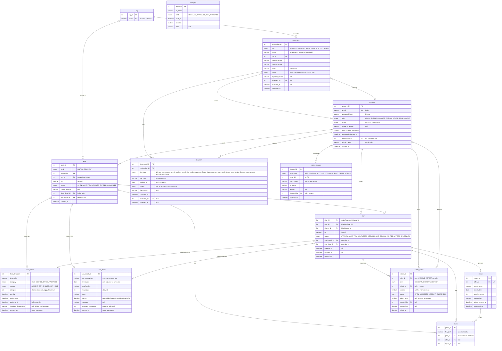

# **ANIPLATO PRD**

## **1. Overview**

ANIPLATO is a desktop app (JavaFX and MySQL) that helps Metro Manila donors give surplus food to food groups before it spoils. It supports SDG 2 (Zero Hunger) and SDG 12 (Responsible Consumption and Production).

* Donors and food groups register with documents. An admin checks them and approves by email.

* A donor is either a Business donor (with permits) or a Casual donor (no permits).

* There are two routes. A donor posts a listing and food groups offer, or a food group posts a request and donors offer.

* The poster accepts one offer. The donor confirms release, then the food group confirms receipt.

* The food group then submits a short report on the event or program that was held.

* Every post ends with a recorded outcome.

* A read-only AI assistant answers questions about the app (stretch goal).

---

## **2. Problem and Evidence**

Businesses throw away edible surplus while parishes, schools, orphanages and charities need it. Coordination runs on paper and personal contacts, so food spoils before it reaches anyone.

| \# | Source | Key finding |
| :---- | :---- | :---- |
| 1 | [IJSTEM study on food bank management, Laguna (2025)](https://iiari.org/wp-content/uploads/ijstem.v5.3.3617.pdf) | No data-driven redistribution system exists; many food banks still coordinate on paper. |
| 2 | [House Bill No. 2196, 20th Congress](https://docs.congress.hrep.online/legisdocs/basic_20/HB02196.pdf) | Tasks DSWD with linking food banks and LGUs into one distribution system. |
| 3 | [A Convergent Systems Approach to Food Loss and Waste in The Philippines](https://www.researchgate.net/publication/399716856_A_Convergent_Systems_Approach_to_Food_Loss_and_Waste_in_The_Philippines) | Names digital surplus redistribution as a key leverage point. |
| 4 | [Food loss and waste in the Philippines: a literature review](https://www.researchgate.net/publication/376952222_Food_loss_and_waste_in_the_philippines_a_literature_review) | Most businesses throw surplus away rather than donate it. |
| 5 | [World Resources Institute, Reducing Food Loss and Waste (2013)](http://pdf.wri.org/reducing_food_loss_and_waste.pdf) | Distance between surplus and food groups blocks redistribution. |
| 6 | [House Bill No. 6525, via Philippine News Agency](https://www.pna.gov.ph/articles/1267682) | Would require businesses to donate edible surplus; cites about 930,000 tons wasted yearly. |
| 7 | [Semeniano et al. (2025), Philippine Journal of Development, PIDS](https://doi.org/10.62986/pjd2025.49.2b) | 31.4% of households faced moderate to severe food insecurity in 2023\. |

---

## **3. Objectives and Metrics**

* Get surplus food to food groups before it spoils.

* Let only verified organizations take part.

* Close every post with an outcome: rescued, expired or cancelled.

* Have food groups show what was done with the food.

"Posts" means listings and requests together. Every number is worked out, never stored.

| Metric | Definition |
| :---- | :---- |
| KG posted | Listing kg plus requested kg |
| KG rescued | kg of completed offers |
| KG expired | kg of posts that expired with nothing rescued. A request filled for less than it asked is Rescued, not expired |
| Rescue rate | kg rescued ÷ kg posted, over closed posts, leaving out cancelled ones. A request filled for less than it asked counts only the accepted offer's kg, so the shortfall lowers the rate |
| Offer acceptance rate | Posts with an accepted offer ÷ posts with at least one offer |
| Lapse rate | Lapsed offers ÷ accepted offers |
| Handoffs completed | Count of completed offers |
| People served | Sum of "people served" in submitted reports |
| Report compliance | Reports submitted by the deadline ÷ completed handoffs whose deadline has passed |
| Surplus waiting | kg on Open listings, across all organizations |
| Needed by food groups | kg on Open requests, across all organizations |

---

## **4. Users**

| User | Who they are | What they need |
| :---- | :---- | :---- |
| Admin | Runs the platform | Verify registrations, handle safety notices and flagged reports, suspend accounts, and track results |
| Business donor | Restaurants, bakeries, canteens, caterers and groceries with permits | A quick way to donate surplus of any category instead of throwing it away |
| Casual donor | Households, event hosts, market stalls and small farms with a large surplus and no permits | A way to donate raw and sealed-packaged food without business paperwork |
| Food group | Parishes, schools, orphanages, charities, feeding programs and volunteer groups with a standing feeding activity | One place to find surplus, or to ask for the food they need |

There are three roles: Business donor, Casual donor and Food group. There is no organization type. An account has one role. An organization that wants to both donate and receive registers a second account with a different email.

---

## **5. Scope**

**In scope:**

* Registration with documents, admin review, and results by email

* Listings and requests, offers across cities, accepting one offer, and a two-step handoff

* A documentation report from the food group after each handoff

* Profile with document renewal, upgrade from Casual to Business, and password change

* Cancellation, lapse and expiry handling

* Safety notices, flagged reports and account suspension

* Metrics and reports for the admin

* Read-only AI assistant (stretch)

**Out of scope:** delivery, selling food, maps, in-app notifications, a web version, and legal protection (ANIPLATO grants none; see Stage 2).

**Demo:** one full loop of each route from registration to a rescued post with its report, plus one expired post and one suspended account.

---

# **6. How ANIPLATO Works**

This section says what the app does, step by step. Each stage has the same parts: Who, Needs, Does, Result, then its rules and legal basis.

## **6.1 The Big Picture**

* Register and get checked by the admin

* Post: a donor posts a listing (Route 1) or a food group posts a request (Route 2)

* Offer: food groups offer on a listing, or donors offer on a request

* Accept: the poster accepts one offer

* Handoff: the donor confirms release, then the food group confirms receipt. The food group then submits a report

* Close: Rescued, Expired or Cancelled

Safety notices and suspensions can happen at any time after an offer is accepted.

## **6.2 Step by Step**

### **Stage 1: Register and get verified**

| Component | Detail |
| :---- | :---- |
| **Who** | New Business donor, Casual donor or Food group. |
| **Needs** | Nothing. No account exists yet. |
| **Does** | Fills one form for every role: name, city, contact person, contact number and email. A Casual donor enters their own name or household name, and their own name as the contact person. Picks Donor or Food group. A donor then picks "I have a Mayor's Permit and Sanitary Permit" (Business) or "I don't have permits" (Casual). Uploads the documents for the role, each with its expiry date. Agrees to the consent text. |
| **Result** | Registration is Pending. The user gets a "Received" email. |

| Role | Required documents |
| :---- | :---- |
| Business donor | Mayor's Permit and Sanitary Permit. FDA License to Operate only if the business makes or repacks food. DTI, SEC or CDA registration only if the permit does not show the business name clearly enough for the name check. |
| Casual donor | One Barangay Certificate, with an entered expiry date. |
| Food group | One credential (DSWD, PCNC, SEC non-stock, DepEd/CHED/TESDA, or a diocese endorsement for parishes) plus an authorization letter naming the contact person. |

**Rules**

* Every document needs an expiry date. "No expiry" only where the document has none. Permits and the Barangay Certificate always need a date.
* No government IDs. Files are visible only to the applicant and the admin.
* Approve only if every document is unexpired and matches the name and city. Casual donor: the admin checks the Barangay Certificate against name and city. The phone number is entered, not verified.
* Approve creates the account and emails a temporary password.
* Reject requires a reason, which is emailed. The applicant may register again.
* The temporary password never expires. Login with it reaches only Change Password until a new one is set.
* The role is fixed at registration. It sets the required documents and the food categories a donor may post: Business raw, packaged, baked and cooked; Casual raw and sealed-packaged only.
* A business without both permits is not rejected. It registers as Casual. To upgrade, it uploads the permits, which creates a new registration for the same account, reviewed like any other. Approval changes the role to Business and points the account to the new registration. The old one stays as history. A rejected upgrade changes nothing.
* A food group needs a standing feeding activity (feeding program, parish pantry, school feeding, volunteer group). One-off individual volunteers are not accepted.
* No organization type is collected. A Casual donor gives no pickup location at registration. Pickup details go in each listing's handover instructions.

**Legal basis**

* Mayor's Permit and Sanitary Permit: required of every business donor.
* FDA License to Operate: only makers and repackers of packaged food.
* Food groups upload one credential matching their kind of organization.
* RA 10173 (Data Privacy Act): collect only what is needed, and no government IDs. A Barangay Certificate is a local government document, not a government ID.
* Casual donors are limited to raw and sealed-packaged food because they have no Sanitary Permit. This is a platform rule, not a legal one.

### **Stage 2: Post a listing or a request**

Items in the viewer's own city come first, and items from other cities are listed below them. Nothing is hidden, and offers can be sent across cities.

**2A: A donor posts a listing (Route 1)**

| Component | Detail |
| :---- | :---- |
| **Who** | Business donor or Casual donor. |
| **Needs** | Account is Active (not Suspended). All documents are current. |
| **Does** | Enters description, category, kg, use-by time and pickup window, and picks a storage condition. Uploads 1 to 5 photos. Allergen labels and handover instructions are optional. Ticks the donor attestation. |
| **Result** | Listing is Open. Food groups can see it, with listings in their own city first. The attestation is saved with a timestamp. |

**Rules**

* kg above 0. Use-by in the future. Pickup window ends before the use-by.
* 1 to 5 photos.
* Category follows the role: Business may pick raw, packaged, baked or cooked. Casual may pick raw or sealed-packaged only.
* Attestation ticked: the food is wholesome, labeled and donated in good faith, with no milk products, no tomato- or milk-based cooked food, and no food already served.
* Storage condition required:
  * Ambient Dry: room temperature (22 to 28 °C), sealed containers.
  * Chilled Cold-Chain: 4 °C or below, the group brings a cooler.
  * Hot Hold: above 60 °C, pick up within 90 minutes.
* Allergen labels are optional and informational: Gluten / Wheat, Dairy / Butter, Nuts / Peanuts, Eggs, Halal Ingredients.
* Handover instructions stay hidden until the offer is accepted.
* A Suspended account cannot post. Its Open listings are hidden from food groups until it is reinstated.
* Food groups cannot post listings or re-post. Leftovers mean the group asked for or accepted more than it needed.

**2B: A food group posts a request (Route 2)**

| Component | Detail |
| :---- | :---- |
| **Who** | Food group. |
| **Needs** | Account is Active (not Suspended). All documents are current. |
| **Does** | Describes the food needed and picks the categories it will accept. Enters kg needed and a needed-by date and time. Names the event or program: its name, date, who it feeds and how many. Gives the place where the food should go. Uploads 1 to 5 photos of past events or the venue, or of the recipients if it is a new event. Message is optional. Ticks the group attestation. |
| **Result** | Request is Open. Donors can see it, with requests in their own city first. The attestation is saved with a timestamp. |

**Rules**

* kg above 0. Needed-by in the future. Event date on or after the needed-by.
* 1 to 5 photos.
* Group attestation ticked: the food is given free and not sold, handled safely, photos show no identifiable children, and identifiable adults consented.
* A group can have several Open requests at once (for example one per event).
* A Casual donor sees, and can offer on, only requests that accept raw or sealed-packaged food, and only in those categories.
* A request reaching its needed-by with no donor chosen expires.
* A Suspended group cannot post. Its Open requests are hidden from donors until it is reinstated. An overdue report does not block posting.

**Legal basis**

* RA 9803 (Food Donation Act): covers apparently wholesome food. It excludes milk products, tomato- or milk-based cooked food, and food already served. These are blocked by category and the attestation.
* Good-faith donors are not liable except for gross negligence or intentional misconduct. The timestamped attestation records good faith. ANIPLATO itself grants no protection.
* Beneficiaries must not pay, so groups confirm free distribution and no resale.
* RA 10173: photos of identifiable people are personal data, so they need adult consent and show no identifiable children.

### **Stage 3: Send offers**

Both routes use the same pattern. The side that did not post sends offers.

**3A: Food groups offer on a listing (Route 1)**

| Component | Detail |
| :---- | :---- |
| **Who** | Food group. |
| **Needs** | Listing is Open. The group has not already offered on it. The group account is Active (not Suspended). The listing can be in any city. |
| **Does** | Sends one offer for the whole quantity. States how the food will be used, who benefits and how many, the place, and a pickup time. Uploads 1 to 5 photos of past events or the venue, or of the recipients if it is a new event. Message is optional. Ticks the group attestation. |
| **Result** | Offer is Offered. The donor can see it. |

**Rules**

* One offer per group per listing, for the whole quantity. No partial amounts.
* Pickup time inside the listing's pickup window and before the use-by.
* 1 to 5 photos. Group attestation ticked.
* Only the donor and the offering group can see the offer.
* A group can withdraw until the donor decides. An unanswered offer expires (see 6.4).
* A Suspended group cannot offer. An overdue report does not block offering.

**3B: Donors offer on a request (Route 2)**

| Component | Detail |
| :---- | :---- |
| **Who** | Business donor or Casual donor. |
| **Needs** | Request is Open. The donor has not already offered on it. The donor account is Active (not Suspended). The request can be in any city. |
| **Does** | Sends one offer. Describes the food, picks its category and storage condition, and adds optional allergen labels. Enters kg, the use-by time and a pickup window. Handover instructions are optional. Uploads 1 to 5 photos of the food. Ticks the donor attestation. |
| **Result** | Offer is Offered. The food group can see it. |

**Rules**

* One offer per donor per request.
* kg above 0 and not above the requested kg. A smaller amount is allowed.
* Use-by in the future. The pickup window ends before both the use-by and the request's needed-by.
* Category must be one the request accepts. Casual donors: raw or sealed-packaged only.
* Storage condition required. 1 to 5 photos. Donor attestation ticked.
* Handover instructions stay hidden until the offer is accepted.
* Only the food group and the donor that sent an offer can see it. Competing offers are hidden from other donors.
* A donor can withdraw until the food group decides. An unanswered offer expires (see 6.4).
* A Suspended donor cannot offer.

**Legal basis**

* Same as Stage 2.

### **Stage 4: Accept an offer**

| Component | Detail |
| :---- | :---- |
| **Who** | The poster: the donor on a listing (Route 1), the food group on a request (Route 2). |
| **Needs** | The listing or request is Open with at least one Offered offer. The poster's account is Active (not Suspended). |
| **Does** | Looks at the offers, with their details and photos, and picks one to accept. Can also decline any single offer. |
| **Result** | That offer is Accepted. All other Offered offers on the same post are Declined. The post is Accepted. Both sides see each other's contact number, and the food group sees the donor's handover instructions. The agreed kg is fixed. |

**Rules**

* Accepting one offer and declining the others is one database transaction. If any part fails, nothing changes.
* Only an Offered, unexpired offer can be accepted.
* The offer is the offerer's confirmation and the accept is the second, so contact numbers are revealed at acceptance with no extra step.
* Agreed kg: the whole listing quantity on Route 1, the accepted offer's kg on Route 2 (even if less than requested).
* Contact numbers are shown only to the two sides of the accepted offer, until the handoff closes.
* The poster can decline an Offered offer any time before accepting one. The offerer sees Declined, cannot offer again on that post, and keeps it in history.
* Once accepted, the offerer cannot withdraw. Only the poster can cancel.
* A Suspended account cannot accept. Offers from a Suspended offerer are hidden from the poster until it is reinstated.
* An Accepted post takes no new offers.

**Legal basis**

* RA 10173: share contact numbers only when needed, so only between the two sides of an accepted offer.

### **Stage 5: Handoff and report**

| Component | Detail |
| :---- | :---- |
| **Who** | The donor first, then the food group. |
| **Needs** | The offer is Accepted. |
| **Does** | At pickup, the donor confirms release. After that, the food group confirms receipt. The food group then submits a short documentation report before its deadline. |
| **Result** | The offer is Completed and the post is Rescued. A handoff record is created automatically and shows in both histories. Once submitted, the report shows on the record. |

**Handoff rules**

* Receipt can be confirmed only after the donor confirms release. Neither step needs photos.
* Confirming receipt creates the handoff record: names, food, agreed kg, times and stated use. It always says it is not a government certificate.

**Report rules**

* One report per handoff, due 7 days after receipt is confirmed.
* Contents: event or program name and date (prefilled), people actually served, a short description, and 1 to 5 photos.
* The group ticks the photo consent statement: no identifiable children, and consent from identifiable adults.
* The donor sees the report on the handoff record, read-only. The donor does not approve or reject it.
* The report never holds up closing the post. A Suspended group can still submit it.
* Report overdue: the system flags the group to the admin. The admin dismisses the flag or suspends the account, with a note. No automatic suspension, and nothing is blocked.
* The group can still submit late. The flag then shows "submitted late".

**Legal basis**

* RA 9803: certificates of acceptance and fitness come from DSWD and the Red Cross. The handoff record is not one of them.
* RA 10173: report photos carry the same consent statement as offers.

### **Stage 6: Close**

| Component | Detail |
| :---- | :---- |
| **Who** | The system, the poster, or the offerer who lapses. |
| **Needs** | A post has reached its deadline, had a missed pickup, been cancelled by its poster, or completed the handoff. |
| **Result** | The post ends as Rescued, Expired or Cancelled. A missed pickup ends as Expired. |

**Rules**

* The poster can cancel an Open or Accepted post, with a reason. No cancelling after the handoff completes.
* Offers affected by a cancellation are declined or cancelled (see 6.4). Each offerer sees the reason.
* Lapse: an Accepted offer with no handoff 2 hours after its pickup time (Route 1) or pickup window end (Route 2) becomes Lapsed, and the post becomes Expired.
* A lapsed post stays Expired. To try again, the poster makes a new post. Nothing carries over.
* Closing never waits for the report.

**Legal basis**

* RA 9803 guidelines and liability tracking: closing every post with a recorded outcome supports compliance records and transparency for donated surplus.

## **6.3 Account Status and Access**

An account has only two states: Active and Suspended. "Limited" is not a state. It describes what a Suspended account can do.

Suspended access: a Suspended account cannot post, send an offer, or accept an offer. Its Open posts are hidden from the other side, and its Offered offers are hidden from posters, until it is reinstated. Everything else works as normal, including finishing handoffs already accepted, submitting reports, flagging concerns, uploading renewals, and updating the profile.

**Account changes:**

* (none) → Active: admin approves registration, all documents current. Email with temporary password sent.

* Active → Suspended: admin suspends (reason written), or a document expires (automatic).

* Suspended → Active: admin reinstates (reason written), or a renewal is uploaded and verified for a document-expiry suspension.

**Registration changes:**

* (none) → Pending: user submits registration, or a Casual donor submits an upgrade.

* Pending → Approved: admin approves. A new registration creates the account. An upgrade moves the existing account to the new registration and changes its role.

* Pending → Rejected: admin rejects with a reason. User may register again. A rejected upgrade changes nothing.

**Safety notices:** either side of an Accepted or Completed offer can flag a safety concern about the other. The other party and the admin are notified. The admin dismisses the notice or suspends the account responsible, with a note. A flagged overdue report is a notice raised by the system.

## **6.4 Status Tables**

**Listing or request changes** (one status set for both):

* Open → Accepted: the poster accepts an offer. Other offers are declined.

* Open → Expired: the use-by (listing) or the needed-by (request) passes. Its Offered offers expire with it.

* Open → Cancelled: the poster cancels with a reason. All waiting offers are declined.

* Accepted → Rescued: the donor confirms release, then the food group confirms receipt. Handoff record is created.

* Accepted → Expired: pickup time \+ 2 hours passes with no handoff. The offer lapses.

* Accepted → Cancelled: the poster cancels with a reason. The accepted offer is cancelled.

**Offer changes:**

* (none) → Offered: the offerer submits, and the rules for its route pass.

* Offered → Withdrawn: the offerer withdraws before the poster decides.

* Offered → Expired: the pickup time passes with no answer (Route 1), or the pickup window ends or the request expires (Route 2).

* Offered → Declined: the poster declines it, accepts another, or cancels the post.

* Offered → Accepted: the poster accepts this one. Contacts are revealed.

* Accepted → Completed: both sides confirm the handoff.

* Accepted → Lapsed: pickup time \+ 2 hours passes with no handoff. The post expires.

* Accepted → Cancelled: the poster cancels the post. The reason is shown to the offerer.

## **6.5 Who Can Do What**

A Suspended account has the same permissions as its role, except it cannot post, send an offer or accept an offer.

| Action | Business donor | Casual donor | Food group | Admin |
| :---- | :---: | :---: | :---: | :---: |
| Post a listing | ✓ | ✓ (raw, sealed-packaged only) | | |
| Post a request | | | ✓ | |
| Cancel own post | ✓ | ✓ | ✓ | |
| Accept or decline offers on own post | ✓ | ✓ | ✓ | |
| Offer on a request | ✓ | ✓ (raw, sealed-packaged only) | | |
| Offer on a listing | | | ✓ | |
| Withdraw own offer | ✓ | ✓ | ✓ | |
| Confirm release | ✓ | ✓ | | |
| Confirm receipt | | | ✓ | |
| Submit the report | | | ✓ | |
| See the report on a handoff | ✓ | ✓ | ✓ | |
| Flag a safety concern | ✓ | ✓ | ✓ | |
| Upload renewals, edit profile | ✓ | ✓ | ✓ | |
| Upgrade to Business | | ✓ | | |
| Approve or reject registrations and upgrades | | | | ✓ |
| Dismiss notices | | | | ✓ |
| Suspend and reinstate accounts | | | | ✓ |
| View the metrics | | | | ✓ |

Nobody else can see an offer except the poster and the offerer.

## **6.6 Automatic Checks**

One function, `runMaintenance()`, runs every time a screen loads. It does these in order:

* Accepted offer 2 hours past its pickup time (or pickup window end) with no handoff: offer becomes Lapsed, post becomes Expired.

* Open listing with use-by passed: listing becomes Expired, its Offered offers expire.

* Open request with needed-by passed: request becomes Expired, its Offered offers expire.

* Offered offer with pickup time (or pickup window end) passed: offer becomes Expired.

* Completed handoff whose report is past due: flag the group to the admin, once per handoff.

* Document expiring in 30 days or less: show a warning.

* Document expired: account becomes Suspended (reason 'Document expired').

## **6.7 Settings**

* Lapse grace period: 2 hours after the pickup time

* Report deadline: 7 days after receipt

* Document expiry warning: 30 days before

* Photos per post, offer and report: 1 to 5

**Assumptions to check:**

- A document expiry suspends the account automatically.

- A Suspended account's Open posts are hidden, and its Offered offers are hidden from posters, until it is reinstated.

- A lapsed post closes as Expired and the poster posts again the normal way.

# **7\. Architecture**

This section says how the app is built, so each rule in Section 6 has one home in the code.

## **7.1 Overview**

JavaFX desktop app, MVC, MySQL over JDBC.

```
View (FXML)  →  Controller  →  Service  →  DAO  →  MySQL
                    ↑
             Model (entities + statuses, used by all layers)
```

* View: FXML and CSS drawn from Figma. No logic.

* Controller: one thin class per screen. Reads input, calls a service, shows the result.

* Service: holds the rules from Section 6\. The only layer allowed to change data.

* DAO: SQL only, one per table.

* Model: entities and their status enums.

## **7.2 Project Tree**

Screens used by both donors and food groups are shared. File names are confirmed when the screens are built.

```
aniplato/
├── pom.xml                              (must copy *.fxml and *.css from src/main/java)
├── README.md
├── docs/
│   └── ARCHITECTURE.md
├── sql/
│   ├── schema.sql
│   └── seed.sql
├── uploads/                             (local file storage, git-ignored)
└── src/main/
    ├── java/com/aniplato/
    │   ├── Main.java
    │   │
    │   ├── model/                       (enums nested inside)
    │   │   ├── Account                  (abstract; Role, Status)
    │   │   ├── Admin
    │   │   ├── Donor                    (business or casual)
    │   │   ├── FoodGroup
    │   │   ├── City
    │   │   ├── Registration             (Status)
    │   │   ├── Document                 (Type, Review)
    │   │   ├── Post                     (Kind, Status)
    │   │   ├── Offer                    (Status)
    │   │   ├── FoodDetail               (Category, Storage, Allergen)
    │   │   ├── UseDetail
    │   │   ├── Report
    │   │   └── SafetyNotice             (Kind, Status)
    │   │
    │   ├── view/                        (FXML + CSS, mirrors controller/)
    │   │   ├── aniplato.css
    │   │   ├── login.fxml
    │   │   ├── register.fxml
    │   │   ├── register-step2.fxml
    │   │   ├── register-submitted.fxml
    │   │   ├── profile.fxml
    │   │   ├── admin/
    │   │   │   ├── dashboard.fxml
    │   │   │   ├── pending-registrations.fxml
    │   │   │   ├── review-registration.fxml
    │   │   │   ├── accounts.fxml
    │   │   │   ├── safety-notices.fxml
    │   │   │   └── reports.fxml
    │   │   ├── donor/
    │   │   │   ├── dashboard.fxml
    │   │   │   ├── new-listing.fxml
    │   │   │   ├── browse-requests.fxml
    │   │   │   └── make-offer.fxml
    │   │   ├── foodgroup/
    │   │   │   ├── dashboard.fxml
    │   │   │   ├── new-request.fxml
    │   │   │   ├── browse-listings.fxml
    │   │   │   └── make-offer.fxml
    │   │   └── shared/
    │   │       ├── shell.fxml
    │   │       ├── my-posts.fxml
    │   │       ├── post-offers.fxml
    │   │       ├── my-offers.fxml
    │   │       ├── history.fxml
    │   │       ├── handoff-record.fxml
    │   │       ├── submit-report.fxml
    │   │       └── dialog.fxml
    │   │
    │   ├── controller/                  (thin: one per screen, same names)
    │   │   ├── ShellController
    │   │   ├── LoginController
    │   │   ├── RegisterController
    │   │   ├── RegisterStep2Controller
    │   │   ├── RegisterSubmittedController
    │   │   ├── ProfileController
    │   │   ├── admin/
    │   │   │   ├── AdminDashboardController
    │   │   │   ├── PendingRegistrationsController
    │   │   │   ├── ReviewRegistrationController
    │   │   │   ├── AccountsController
    │   │   │   ├── SafetyNoticesController
    │   │   │   └── ReportsController
    │   │   ├── donor/
    │   │   │   ├── DonorDashboardController
    │   │   │   ├── NewListingController
    │   │   │   ├── BrowseRequestsController
    │   │   │   └── DonorMakeOfferController
    │   │   ├── foodgroup/
    │   │   │   ├── FoodGroupDashboardController
    │   │   │   ├── NewRequestController
    │   │   │   ├── BrowseListingsController
    │   │   │   └── FoodGroupMakeOfferController
    │   │   └── shared/                  (same screen for donor and food group)
    │   │       ├── MyPostsController
    │   │       ├── PostOffersController
    │   │       ├── MyOffersController
    │   │       ├── HistoryController
    │   │       ├── HandoffRecordController
    │   │       ├── SubmitReportController
    │   │       └── DialogController    (all popups)
    │   │
    │   ├── service/                     (all the rules live here)
    │   │   ├── AuthenticationService
    │   │   ├── RegistrationService
    │   │   ├── PostService
    │   │   ├── OfferService
    │   │   ├── ReportService
    │   │   ├── SafetyService
    │   │   ├── StatsService
    │   │   ├── MaintenanceService
    │   │   ├── FileStorageService
    │   │   └── EmailService
    │   │
    │   ├── dao/                         (one per table, SQL only)
    │   │   ├── CityDao
    │   │   ├── AccountDao
    │   │   ├── RegistrationDao
    │   │   ├── DocumentDao
    │   │   ├── PostDao
    │   │   ├── OfferDao
    │   │   ├── DetailDao                (food_detail and use_detail)
    │   │   ├── PhotoDao
    │   │   ├── ReportDao
    │   │   ├── SafetyNoticeDao
    │   │   └── LogDao                   (status_change and email_log)
    │   │
    │   ├── exception/
    │   │   └── RuleViolationException
    │   │
    │   └── util/
    │       ├── Database                 (only place that opens connections)
    │       ├── PasswordHasher
    │       ├── Settings
    │       ├── Session
    │       ├── SvgIcon
    │       └── Navigator                (only place that knows view paths)
    │
    └── resources/
        ├── db.properties                (git-ignored)
        └── email/                       (3 HTML templates)
```

## **7.3 Services**

* **AuthenticationService**
  * Checks email and password (BCrypt).
  * Blocks login until the temporary password is replaced.
  * Changes passwords (at least 8 characters, different from the current one).

* **RegistrationService**
  * Saves registrations and upgrades with their documents, and sends the "Received" email.
  * Approve is one transaction: creates the account (or moves it to the new registration) and emails the result.
  * Reject saves the reason and emails it.
  * Handles renewals, document verification, profile edits, and suspend and reinstate.

* **PostService**
  * Creates and validates listings and requests.
  * Cancels posts and settles their offers.
  * Queries Open posts (viewer's city first, suspended posters hidden) and a user's own posts.

* **OfferService**
  * Sends, withdraws, declines and accepts offers (accept is one transaction).
  * Confirms release, then receipt (one transaction that completes the offer and rescues the post).
  * Builds the handoff record.
  * Returns contact numbers to allowed viewers only.

* **ReportService**
  * Saves the documentation report and works out its deadline.
  * Raises the overdue flag through SafetyService.

* **SafetyService**
  * Saves safety notices and overdue flags.
  * Dismisses a notice, or suspends the account responsible through RegistrationService.

* **StatsService**
  * Works out every metric in Section 3.
  * Builds History.

* **MaintenanceService**
  * Runs the checks in 6.6 on every screen load.
  * Asks the owning services to make the changes. Holds no rules.

* **FileStorageService**
  * Saves uploads (PDF, JPG, PNG; max 5 MB) under `uploads/`.
  * Returns the relative path.

* **EmailService**
  * Fills the HTML templates and sends through Jakarta Mail.
  * Logs every send.

## **7.4 Rules**

* Controllers never call DAOs and hold no rules. They call services and show results.

* An action that changes more than one table (accept, handoff, cancel, approve) is one service method and one transaction. If any part fails, nothing changes.

* Every status change goes through its owning service, which also writes the status-change log.

* MaintenanceService changes data only by calling other services.

* Shared screens never check the user's role. They ask for "my" data, and role differences come from the Account subclass or from what the data contains.

* All popups go through DialogController with their own wording.

* List queries never include phone numbers. One method returns them, only to the owner, an admin, or the other side of an accepted, not yet closed offer.

* Rule problems are thrown as `RuleViolationException` and shown to the user as a message.

* Store statuses, timestamps and entered facts. Derive rates, totals, counts, deadlines and expiry warnings.

## **7.5 Technical Choices**

* Database: MySQL over direct JDBC.

* Passwords: BCrypt.

* Email: Jakarta Mail.

* Files: local disk with relative paths in the database. PDFBox for PDF preview.

* Build: Maven. `pom.xml` must also copy `.fxml` and `.css` from `src/main/java`, or screens fail to load at startup.

## **7.6 Data Model**

Thirteen tables. One post table and one offer table serve both routes. Two detail tables hold what differs: **food_detail** (what the donor gives) and **use_detail** (what the food group needs or will do with it). Organization details live only in registration, and the account holds the login.



**Reading the diagram**

* Route 1: the post (a listing) has food details, and each offer has use details. Route 2: the post (a request) has use details, and each offer has food details. A check on both tables requires exactly one detail link, opposite on the offer to the post.
* A registration has many documents. The account points to its current registration. An upgrade adds a registration, and approval moves the account to it.
* A document renewal is a new row. A photo belongs to exactly one of post, offer or report, and the service allows 1 to 5 per owner.
* `status_change` is append-only. `email_log` records every email sent.
* Not stored, always worked out: all metrics, the report deadline, the handoff number, the offer's pickup deadline, the agreed kg, the account a notice is about, the document in force (the latest one with review OK for each type), and "submitted late".

**Assumptions to check:**

* Database credentials sit on each computer. Acceptable for a prototype only.

* Files on local disk are not shared between computers.

---

# **Appendix A. App Wording and Settings**

* **Registration consent:** "I agree that ANIPLATO may store my organization's details and documents to verify my organization. Only my organization and the ANIPLATO admin can see my files."

* **Donor attestation:** "This food is apparently wholesome, properly labeled and donated in good faith. It contains no milk products, no tomato- or milk-based cooked food, and no food already served to diners."

* **Group attestation:** "We will give this food away free, will not sell it, and will handle it safely after pickup. Photos show no identifiable children, and identifiable adults have consented."

* **Report photo consent:** "Photos show no identifiable children, and identifiable adults have consented."

* **Safety notice:** "The other party and the ANIPLATO admin will be notified. The admin may dismiss the notice or suspend the account responsible."

* **Handoff record:** "This is an ANIPLATO platform record, not a certificate issued by DSWD, the Philippine Red Cross or any government agency."

* **Emails:** Received (confirms the submission); Approved (temporary login, set a password on first login); Not approved (the admin's reasons, register again).