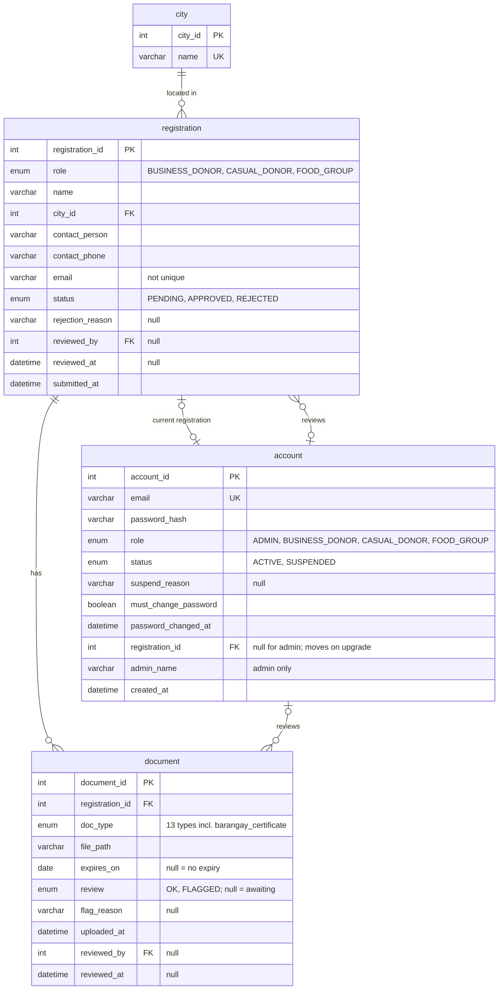
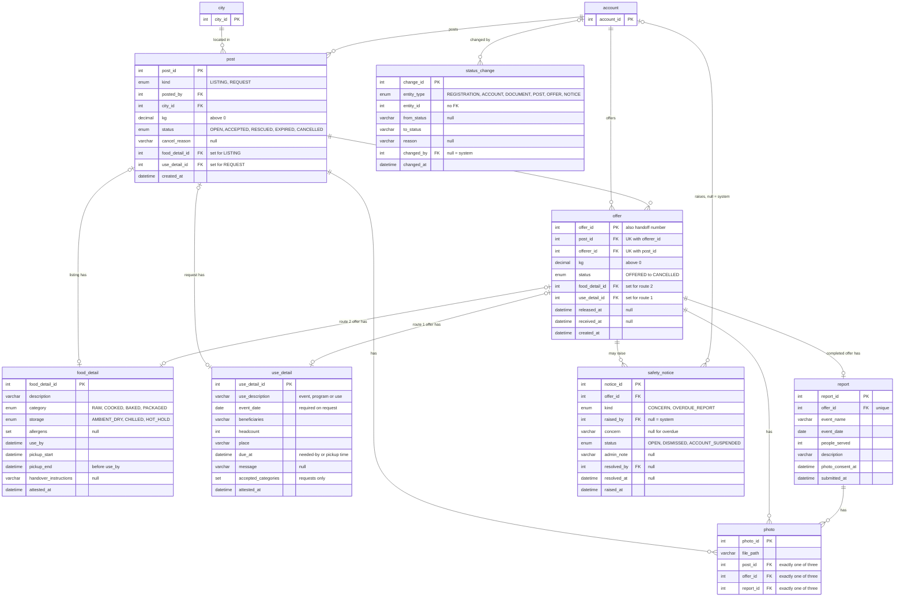

# ANIPLATO Redesign Draft (running doc)

Status: brainstorming output. `Project Spec.md` is unchanged. Everything not listed here follows the old model in the spec. Changes are finalized in this doc first, then applied to the spec, then to the code and SQL. Where the two disagree, this draft is the proposed change.

Note for the spec revision: rule IDs (R1.1, A2 and so on) are dropped in this draft and will be dropped from the spec when it is revised. Rules are plain bullets for now.

## 1. Core

ANIPLATO is a matchmaker with receipts: a listing or request, a commitment, a physical exchange, and proof that it happened. Verification exists only to make those receipts believable.

## 2. Actors

There are three roles, chosen at registration:

- **Business donor** and **Casual donor** only give.
- **Food group** only receives. It needs a standing feeding activity (feeding programs, parishes, volunteer groups). One-off individual volunteers are out of scope; they can partner with an established group.
- Every registration is admin-approved. Casual donors get a lighter review.
- One role per account. An organization that wants to both donate and receive registers a second account.
- There is no organization type. The role is the only classification.

## 3. Roles

| | Business donor | Casual donor (new) | Food group |
| :-- | :-- | :-- | :-- |
| Who | Restaurants, bakeries, canteens, caterers, groceries | Anyone with a large surplus and no permits | Parishes, schools, orphanages, charities, feeding programs, volunteer groups |
| Gives or receives | Gives | Gives | Receives |
| Documents | Business Permit and Sanitary Permit | Barangay Certificate | One credential (DSWD, PCNC, SEC non-stock, DepEd/CHED/TESDA, or a diocese endorsement) plus an authorization letter |
| Extra | FDA License only if they make or repack food. DTI, SEC or CDA registration only if the permit does not show the business name clearly | None | None |
| Food categories | Raw, packaged, baked, cooked | Raw and sealed-packaged only | Not applicable |

- Both donor roles use the same screens. The role only changes the required documents and the food categories offered on the listing form.
- Business donors can post more food categories. That is their advantage over Casual donors.
- A business that can't show both permits registers as Casual and can upgrade later.
- No kg cap for Casual donors. The category limit already controls the risk, and the food group decides whether to take the amount.

## 4. Interaction flows

**Route 1: donor first**
1. The donor posts a listing, with details and photos.
2. Food groups send offers, with details and photos.
3. The donor chooses one and confirms.

**Route 2: food group first (new)**
1. The food group posts a request, with details and photos.
2. Donors offer to fulfill it, with details and photos.
3. The food group chooses one and confirms.

**Both routes then continue as follows**
1. Once both sides have confirmed, contact numbers are revealed so they can arrange the courier or physical exchange.
2. The donor confirms release.
3. The food group confirms receipt. This automatically creates a handoff record that shows in both parties' history.
4. The food group is given a deadline to submit a simple documentation report showing the event or program that was held. The donor can see it.
5. If the group can't comply, it is flagged to the admin, who decides whether to suspend. There is no automatic suspension for an overdue report, unlike an expired document.

## 5. Food groups can no longer post listings (new)

- With more coordination, both sides can agree on the amount (kg) before committing.
- Re-posting surplus no longer makes sense. Donations happen in bulk, so leftovers after a program mean the group requested or accepted more than it needed.

## 6. Full flows (stage by stage)

Same format as the spec's section 6: Who, Needs, Does, Result, Legal basis, Rules. All six stages are drafted.

### Stage 1: Register and get verified

| Component | Detail |
| :-- | :-- |
| **Who** | New Business donor, Casual donor or Food group. |
| **Needs** | Nothing. No account exists yet. |
| **Does** | Fills one shared form for all roles: name, city, contact person, contact number, email. A Casual donor enters their own name or household name, and their own name as the contact person. Picks **Donor** or **Food group**. If Donor, picks "I have a Mayor's Permit and Sanitary Permit" (Business) or "I don't have permits" (Casual). Uploads the documents for that role, each with its expiry date. Agrees to the consent text. |
| **Result** | Registration is Pending. The user gets a "Received" email. |

**Required documents by role**

| Role | Documents |
| :-- | :-- |
| Business donor | Mayor's Permit and Sanitary Permit. FDA License to Operate only if the business makes or repacks food. DTI, SEC or CDA registration only if the permit does not show the business name clearly enough for the name check. |
| Casual donor | One Barangay Certificate, with an entered expiry date. |
| Food group | One credential (DSWD, PCNC, SEC non-stock, DepEd/CHED/TESDA, or a diocese endorsement for parishes) plus an authorization letter naming the contact person. |

**Rules**
- Each document needs an expiry date. "No expiry" is allowed only where the document truly has none. Permits and the Barangay Certificate always need an explicit date, with no "No expiry" option.
- No government IDs are collected.
- Files are visible only to the applicant and the admin.
- The admin can approve only if every document is not expired and matches the name and city. For a Casual donor the review is lighter: the admin checks the Barangay Certificate against the name and city. The phone number is only entered, not verified.
- Approve: the account is created and an email sends a temporary password.
- Reject: the admin must write a reason. The reason is emailed. The applicant may register again.
- The temporary password has no time limit. Every login with it goes to Change Password and nothing else is reachable until a new one is set.
- The role is set at registration. It decides the required documents and the food categories a donor may post: Business may post raw, packaged, baked and cooked. Casual may post raw and sealed-packaged only.
- A business that cannot show both permits is not rejected. It may register as Casual, under the Casual limits. To upgrade, the donor uploads the permits, which creates a new registration for the same account. The admin reviews it like any other. On approval the account's role changes to Business and it points to the new registration. The old registration stays as history. A rejected upgrade changes nothing.
- A food group must show a standing feeding activity (feeding program, parish pantry, school feeding, volunteer group). One-off individual volunteers are not accepted.
- One role per account. An organization that wants to both donate and receive registers a second account with a different email.
- No organization type is collected.
- A Casual donor gives no pickup location at registration. Pickup details live in each listing's handover instructions.

**Legal basis**
- Mayor's Permit and Sanitary Permit are required of every business donor. The FDA License to Operate is needed only by makers and repackers of packaged food.
- Food groups upload one credential that matches their kind of organization.
- RA 10173 (Data Privacy Act): collect only what is needed, and no government IDs. A Barangay Certificate is a local government document, not a government ID.
- Casual donors are limited to raw and sealed-packaged food because they have no Sanitary Permit. This is a platform rule, not a legal one.

Screen changes for this stage are listed in section 7.

**Data model notes (for the data model phase)**
- `role` becomes `BUSINESS_DONOR`, `CASUAL_DONOR` or `FOOD_GROUP` in both registration and account, plus `ADMIN` on account only.
- `org_type` is removed.
- Any check that currently reads "role = DONOR" needs to cover both donor roles.

### Stage 2: Post a listing or a request

Two ways in. Stage 2A starts Route 1 and Stage 2B starts Route 2.

**Browsing rule for both:** city is a sort priority, not a filter. Items in the viewer's own city come first, and items from other cities are listed below them. Nothing is hidden, and offers can be sent across cities.

#### Stage 2A: Donor posts a listing (Route 1)

| Component | Detail |
| :-- | :-- |
| **Who** | Business donor or Casual donor. |
| **Needs** | Account is Active (not Suspended). All documents are current. |
| **Does** | Enters description, category, kg, use-by time and pickup window, and picks a storage condition. Uploads 1 to 5 photos. Allergen labels and handover instructions are optional. Ticks the donor attestation. |
| **Result** | Listing is Open. Food groups can see it, with the poster's own city first. The attestation is saved with a timestamp. |

**Rules**
- kg must be above 0.
- Use-by must be in the future. The pickup window must end before the use-by.
- At least 1 and at most 5 photos are required.
- The category choices follow the role: Business may pick raw, packaged, baked or cooked. Casual may pick raw or sealed-packaged only.
- The attestation must be ticked: the food is wholesome, labeled, donated in good faith, and has no milk products, no tomato- or milk-based cooked food, and no food already served.
- A storage condition is required: Ambient Dry, Chilled Cold-Chain or Hot Hold.
- Allergen labels are optional and for information only.
- Handover instructions stay hidden until both sides have confirmed.
- A Suspended account cannot post.
- Food groups cannot post listings and cannot re-post.

#### Stage 2B: Food group posts a request (Route 2, new)

| Component | Detail |
| :-- | :-- |
| **Who** | Food group. |
| **Needs** | Account is Active (not Suspended). All documents are current. |
| **Does** | Describes the food needed and picks the categories it will accept. Enters kg needed and a needed-by date and time. Names the event or program: its name, date, who it feeds and how many. Gives the place where the food should go. Uploads 1 to 5 photos: of past events or the venue, or of the recipients if it is a new event. Message is optional. Ticks the group attestation. |
| **Result** | Request is Open. Donors can see it, with their own city first. The attestation is saved with a timestamp. |

**Rules**
- kg must be above 0.
- Needed-by must be in the future. The event date must be on or after the needed-by.
- At least 1 and at most 5 photos are required.
- The group attestation must be ticked: the food will be given free, not sold, and handled safely, photos show no identifiable children, and identifiable adults have consented.
- A group can have several Open requests at once, for example one per event or program.
- A Casual donor sees and can offer on only the requests that accept raw or sealed-packaged food, and can offer only those categories.
- A request that reaches its needed-by time with no donor chosen expires.
- A Suspended group cannot post.
- An overdue report does not block posting. It only flags the group to the admin (see the report stage).

**Legal basis**
- RA 9803 (Food Donation Act): beneficiaries must not pay anything, so groups confirm free distribution and no resale. The donor attestation records good faith.
- RA 10173 (Data Privacy Act): identifiable people in photos are personal data, so photos need adult consent and show no identifiable children.

**Data model notes (for the data model phase)**
- A listing now has 1 to 5 photos, so it needs its own photo table, like the offer photos.
- A request needs its own fields and photos. The storage is decided in section 8.

### Stage 3: Send offers

Both routes use the same pattern. The side that did not post sends offers. The poster picks one, and the rest are declined (see "When an offer is chosen" below).

#### Stage 3A: Food groups offer on a listing (Route 1)

| Component | Detail |
| :-- | :-- |
| **Who** | Food group. |
| **Needs** | Listing is Open. The group has not already offered on it. The group account is Active (not Suspended). The listing can be in any city. |
| **Does** | Sends one offer for the whole quantity. States how the food will be used, who benefits and how many, the place, and a pickup time. Uploads 1 to 5 photos: past events or the venue, or the recipients if it is a new event. Message is optional. Ticks the group attestation. |
| **Result** | Offer is Offered. The donor can see it. |

**Rules**
- One offer per group per listing.
- The offer is for the whole listing quantity. No partial amounts.
- The pickup time must be inside the listing's pickup window and before the use-by.
- At least 1 and at most 5 photos are required.
- The group attestation must be ticked: the food will be given free, not sold, and handled safely, photos show no identifiable children, and identifiable adults have consented.
- Only the donor and the group that sent an offer can see it.
- A group can withdraw its offer any time before the donor decides.
- An offer nobody answers expires at its pickup time.
- A Suspended group cannot offer. An overdue report does not block offering (it only flags the group to the admin).

#### Stage 3B: Donors offer on a request (Route 2, new)

| Component | Detail |
| :-- | :-- |
| **Who** | Business donor or Casual donor. |
| **Needs** | Request is Open. The donor has not already offered on it. The donor account is Active (not Suspended). The request can be in any city. |
| **Does** | Sends one offer. Describes the food they will give, picks its category and storage condition, and adds optional allergen labels. Enters kg, the use-by time and a pickup window. Handover instructions are optional. Uploads 1 to 5 photos of the food. Ticks the donor attestation. |
| **Result** | Offer is Offered. The food group can see it. |

**Rules**
- One offer per donor per request.
- kg must be above 0 and not more than the requested kg. A smaller amount is allowed.
- Use-by must be in the future. The pickup window must end before both the use-by and the request's needed-by.
- The category must be one the request accepts. A Casual donor can offer only raw or sealed-packaged food.
- A storage condition is required.
- At least 1 and at most 5 photos are required.
- The donor attestation must be ticked, with the same wording as for a listing.
- Handover instructions stay hidden until the food group accepts the offer.
- Only the food group and the donor that sent an offer can see it. Other donors cannot see competing offers.
- A donor can withdraw its offer any time before the food group decides.
- An offer nobody answers expires when its pickup window ends, or when the request expires.
- A Suspended donor cannot offer.

#### When an offer is chosen (both routes)

Stage 4 has the full acceptance rules. The pattern is:
- The poster (the donor on a listing, the food group on a request) accepts one offer. That offer becomes Accepted.
- All other Offered offers on the same listing or request become Declined. They stay in each offerer's history, and those offerers cannot offer again on it.
- The listing or request stops taking new offers.
- Accepting one offer and declining the rest happen together in one transaction. If any part fails, nothing changes.
- The poster can also decline a single offer before choosing.
- On a request, the agreed amount is the accepted offer's kg, even if it is less than requested.

**Legal basis**
- RA 9803 (Food Donation Act): beneficiaries must not pay anything, so groups confirm free distribution and no resale. The donor attestation records good faith.
- RA 10173 (Data Privacy Act): identifiable people in photos are personal data, so photos need adult consent and show no identifiable children.

**Data model notes (for the data model phase)**
- An offer now belongs to either a listing (Route 1) or a request (Route 2).
- A Route 2 offer carries the donor's food details (description, category, storage, allergens, kg, use-by, pickup window, handover instructions, attestation). A Route 1 offer carries the group's use details, as it does today.
- Offer photos already exist. Both kinds of offers need 1 to 5.
- One offer per offerer per listing or request needs a uniqueness rule in each case.

### Stage 4: Accept an offer

| Component | Detail |
| :-- | :-- |
| **Who** | The poster: the donor on a listing (Route 1), the food group on a request (Route 2). |
| **Needs** | The listing or request is Open with at least one Offered offer. The poster's account is Active (not Suspended). |
| **Does** | Looks at the offers, with their details and photos, and picks one to accept. Can also decline any single offer. |
| **Result** | That offer is Accepted. All other Offered offers on the same listing or request are Declined. The listing or request is Accepted. Both sides see each other's contact number, and the food group sees the donor's handover instructions. The agreed kg is fixed. |

**Rules**
- Accepting one offer and declining the others happen together in one transaction. If any part fails, nothing changes.
- Only an Offered offer that has not expired can be accepted.
- The offer itself is the offerer's confirmation. The poster's accept is the second confirmation, so contact numbers are revealed at the moment of acceptance, with no extra step.
- The agreed kg is the whole listing quantity on Route 1, and the accepted offer's kg on Route 2, even if that is less than requested.
- Contact numbers are shown only to the two sides of the accepted offer, until the handoff closes.
- The poster can decline an Offered offer at any time before accepting one. The offerer sees it as Declined and cannot offer again on that listing or request.
- Declined offers stay visible in the offerer's history.
- Once accepted, the offerer cannot withdraw. The offerer contacts the poster, and only the poster can cancel (see the close stage).
- A Suspended account cannot accept an offer. Offers from a Suspended offerer are hidden from the poster until the account is reinstated.
- The listing or request takes no new offers once Accepted.

**Legal basis**
- RA 10173 (Data Privacy Act): contact numbers are shared only when needed, so only between the two sides of an accepted offer.

**Data model notes (for the data model phase)**
- The listing and the request each need an Accepted status.
- Contact numbers are not copied anywhere. One method returns them, only to the owner, an admin, or the other side of an accepted offer that is not yet closed.

### Stage 5: Handoff and report

| Component | Detail |
| :-- | :-- |
| **Who** | The donor first, then the food group. |
| **Needs** | The offer is Accepted. |
| **Does** | At pickup, the donor confirms release. After that, the food group confirms receipt. The food group then submits a short documentation report before its deadline. |
| **Result** | The offer is Completed and the listing or request is closed as fulfilled (the final status names are in the close stage). A handoff record is created automatically and shows in both histories. Once submitted, the report shows on the record. |

**Handoff rules**
- The food group can confirm receipt only after the donor has confirmed release.
- Release and receipt each save their time. Neither needs photos.
- Confirming receipt creates the handoff record automatically. Its number is HR-year-offer id.
- The record shows names, food, agreed kg, times and the stated use. It always says it is a platform record, not a certificate issued by DSWD, the Philippine Red Cross or any government agency.
- The record shows in both parties' history.

**Report rules**
- The report is due 7 days after the food group confirms receipt. The 7 days is a value in Settings.
- There is one report per handoff.
- The report has: the event or program name and date (prefilled from the request or offer), how many people were actually served, a short description of what was held, and 1 to 5 photos.
- The group ticks a photo consent statement: photos show no identifiable children, and identifiable adults have consented.
- The donor can see the report on the handoff record, read-only. The donor does not approve or reject it.
- The report does not hold up closing the listing or request.
- A Suspended group can still submit its report.

**Overdue report**
- If the deadline passes with no report, the system flags the group to the admin.
- The admin can dismiss the flag or suspend the account, with a note.
- There is no automatic suspension and nothing is blocked for the group while the report is overdue.
- The group can still submit late. The flag then shows "submitted late" and the admin decides as before.

**Legal basis**
- RA 9803 (Food Donation Act): certificates of acceptance and fitness come from DSWD and the Red Cross. The handoff record is not one of them.
- RA 10173 (Data Privacy Act): photos of identifiable people are personal data, so reports carry the same consent statement as offers.

**Data model notes (for the data model phase)**
- A new report record belongs to one accepted offer, with the event name and date, the number served, the description and its submitted time. Report photos need their own table (1 to 5).
- The deadline is not stored. It is worked out as the receipt time plus the Settings value.
- The overdue flag needs a home. The existing safety notice table is the closest fit, with a type to tell it apart and no person as the one raising it (the system raises it).

### Stage 6: Close

| Component | Detail |
| :-- | :-- |
| **Who** | The system, the poster (the donor on a listing, the food group on a request), or the offerer who lapses. |
| **Needs** | A listing or request has reached its deadline, had a missed pickup, been cancelled by its poster, or completed the handoff. |
| **Result** | It ends as Rescued, Expired or Cancelled. A missed pickup ends as Expired. |

**Statuses**
- Listings and requests share one status set: Open, Accepted, Rescued, Expired, Cancelled. "Rescued" means the same on both.
- Offers keep their statuses: Offered, Accepted, Completed, Declined, Withdrawn, Expired, Lapsed, Cancelled.

**Status changes, listing or request**
- Open to Accepted: the poster accepts an offer. The other offers are declined.
- Open to Expired: the use-by (listing) or the needed-by (request) passes. Its Offered offers expire with it.
- Open to Cancelled: the poster cancels with a reason. All waiting offers are declined.
- Accepted to Rescued: the donor confirms release, then the food group confirms receipt.
- Accepted to Expired: a missed pickup (see "Lapse" below). The offer lapses.
- Accepted to Cancelled: the poster cancels with a reason. The accepted offer is cancelled.

**Status changes, offer**
- Offered to Withdrawn: the offerer withdraws before the poster decides.
- Offered to Expired: the pickup time passes with no answer (Route 1), or the pickup window ends or the request expires (Route 2).
- Offered to Declined: the poster declines it, accepts another, or cancels the post.
- Offered to Accepted: the poster accepts it.
- Accepted to Completed: both sides confirm the handoff.
- Accepted to Lapsed: the grace period passes with no handoff.
- Accepted to Cancelled: the poster cancels. The reason is shown to the offerer.

**Rules**
- The poster can cancel an Open or Accepted post. A reason is required. After the handoff is complete there is no cancelling.
- If the post was Open, all waiting offers are declined and each offerer sees the reason.
- If the post was Accepted, the accepted offer is Cancelled and its offerer sees the reason.
- Lapse: if an Accepted offer has no handoff 2 hours after its pickup time (Route 1) or the end of its pickup window (Route 2), the offer becomes Lapsed and the post becomes Expired.
- A lapsed post stays Expired. To try again, the poster makes a new post the normal way. Nothing is carried over, and any offerer can offer on it like on any other post.
- A Suspended account cannot post.
- Closing never waits for the report (see Stage 5).

**Automatic checks**

One function runs every time a screen loads, in this order:
1. An Accepted offer 2 hours past its pickup time (or pickup window end) with no handoff: the offer becomes Lapsed and the post becomes Expired.
2. An Open listing past its use-by: the listing becomes Expired and its Offered offers expire.
3. An Open request past its needed-by: the request becomes Expired and its Offered offers expire.
4. An Offered offer past its pickup time (or pickup window end) with no answer: the offer becomes Expired.
5. A completed handoff whose report is past due: the group is flagged to the admin, once per handoff.
6. A document expiring in 30 days or less: show a warning.
7. A document expired: the account becomes Suspended (reason "Document expired").

**Settings**
- Lapse grace period: 2 hours after the pickup time.
- Report deadline: 7 days after receipt.
- Document expiry warning: 30 days before.
- Photos per post, offer and report: 1 to 5.

**Metrics**

Numbers are worked out, not stored. "Posts" means listings and requests together. Each handoff traces to exactly one post, so nothing is counted twice.
- **KG posted:** listing kg plus requested kg.
- **KG rescued:** kg of Completed offers.
- **KG expired:** kg of posts that expired.
- **Rescue rate:** kg rescued ÷ kg posted, over closed posts, leaving out cancelled ones.
- **Offer acceptance:** posts with an accepted offer ÷ posts with at least one offer.
- **Lapse rate:** lapsed offers ÷ accepted offers.
- **Handoffs completed:** count of Completed offers.
- **People served:** the sum of "people served" in submitted reports.
- **Report compliance:** reports submitted by the deadline ÷ completed handoffs whose deadline has passed.
- **Surplus waiting:** kg on Open listings, across all organizations.
- **Needed by food groups:** kg on Open requests, across all organizations.
- Dropped: Offers sent, and a separate KG cancelled tile (cancelled kg is only mentioned in the Reports footnote).

**Legal basis**
- RA 9803 (Food Donation Act): closing every post with a recorded outcome supports compliance records and transparency for donated surplus.

**Data model notes (for the data model phase)**
- Listings and requests need the same status set.
- The offer's pickup deadline is not stored. It is the due time in the use details on a Route 1 offer, or the pickup end in the food details on a Route 2 offer. The automatic checks read whichever exists.
- No metric is stored.

---

## 7. Proposed screen changes (running)

Running list, grouped by module. Frame names are from the Figma file. Each module is added or updated as the flows are rewritten. Items are proposals until the flows are final.

**Labels used on every screen from now on:** Business donor, Casual donor, Food group. This replaces the current "Food Donor" and "Food Organization" badges.

### Registration

**Step 1: Organization** (`REGISTER — STEP 1 ORGANIZATION`)
- Role toggle becomes **Donor | Food group**. Picking Donor shows a second choice: "I have a Mayor's Permit and Sanitary Permit" (Business) or "I don't have permits" (Casual). Business is the default.
- Remove the Organization type dropdown. City takes the full row.
- The name field label and hint follow the role:
  - Business donor: "Business name", hint "As shown on your permits"
  - Casual donor: "Your name or household name", hint "As shown on your Barangay Certificate"
  - Food group: "Organization name", hint "As shown on your credential"
- The city hint follows the role: Mayor's Permit (Business), Barangay Certificate (Casual), registered address (Food group).
- Contact person stays for every role. For Casual, the hint says to enter your own name.
- Contact number and email are unchanged.

**Step 2: Documents, Business donor** (`REGISTER — STEP 2 DOCUMENTS`)
- The "Required for" tag shows only "Business donor" (drop "· Bakery").
- "Business registration (DTI, SEC or CDA)" is no longer required. It becomes optional, with the hint "Only if your permit doesn't show your business name clearly".
- Mayor's Permit and Sanitary Permit stay required. FDA License stays optional.
- The intro sentence keeps "Permits always need a date".

**Step 2: Documents, Casual donor** (new frame: `REGISTER — STEP 2 DOCUMENTS (CASUAL)`)
- The "Required for" tag shows "Casual donor".
- One item only: **Barangay Certificate** (required), with an upload and an expiry date. There is no "No expiry" tick.
- The intro sentence says "The Barangay Certificate always needs an expiry date. Don't upload government IDs."
- The consent box and the Back and Submit buttons are the same as the other steps.

**Step 2: Documents, Food group** (`REGISTER — STEP 2 DOCUMENTS (FOOD GROUP)`)
- The "Required for" tag shows only "Food group" (drop "· Charity").
- Everything else is unchanged.

**Submitted screen and emails:** no change decided yet.

### Admin: accounts and review

**Pending Accounts** (`Pending Accounts`)
- Role badges: Business donor, Casual donor, Food group.
- Remove the Type column.
- An upgrade request is a new pending registration with the role Business donor, so it shows the normal Business donor badge. There is no separate tag, and no "Registered again" tag.

**All Accounts** (`ALL ACCOUNTS`)
- Same badge change and Type column removal.
- The Documents column reads naturally for each role (for example "Barangay Certificate ends Dec 31" for Casual).

**Review Account** (`Review Account` and its Accept and Reject dialogs)
- The Role pill shows Business donor, Casual donor or Food group.
- Remove the Organization type field.
- The document list follows the role: Business shows its permits, Casual shows just the Barangay Certificate, Food group is unchanged.
- The three checks per document stay the same for every role: current and not expired, name matches, issued for the city.

### Profile

**Donor profile** (`DONOR PROFILE`)
- Remove the TYPE field. The Role field shows Business donor or Casual donor.
- The Organization hint changes from "Name, type and city" to "Name and city".
- Casual donor: Documents lists only the Barangay Certificate, and there is an **Upgrade to Business donor** action to upload the Mayor's Permit and Sanitary Permit, plus FDA License if applicable. The admin reviews it and the role changes on approval.
- Business donor: the "Business registration (DTI)" row shows "Not required" when none was uploaded, like the FDA row does today.

**Food group profile** (`FOOD GROUP PROFILE`)
- Remove the TYPE field and change the hint to "Name and city".

### Listings (donor)

**New Listing** (`DONOR NEW LISTING`)
- The Category choices depend on the role:
  - Business donor: Raw, Cooked, Baked, Packaged.
  - Casual donor: Raw and Packaged only, with Cooked and Baked hidden. The Packaged label reads "Sealed packaged" for Casual.
- The category hint adds, for Casual: "Casual donors can post raw and sealed-packaged food only."
- Add a required **Photos** section: upload 1 to 5 photos, with a hint that the photos show the food.
- Everything else on the form is unchanged. Handover instructions stay optional.

**Browse Requests** (new, donor sidebar; mirrors `NEW — FOOD GROUP BROWSE LISTINGS`)
- A list of Open requests: food needed, accepted categories, kg, needed-by, event or program, city.
- Requests in the donor's own city come first, then other cities below. Nothing is hidden.
- A Casual donor sees only the requests that accept raw or sealed-packaged food.
- Each row opens the request details, with a button to offer. The offer form itself is defined in Stage 3.

### Browse Listings (food group)

**Browse Listings** (`NEW — FOOD GROUP BROWSE LISTINGS`)
- Listings in the group's own city come first, then other cities below. Nothing is hidden.
- Any city filter becomes a sort or an optional filter the user chooses, not a built-in restriction.
- Listing details show the donor's photos.

### Requests (food group)

**New Request** (new; replaces `New Listing` in the food group sidebar)
- Sections: Food needed, Quantity and timing, Event or program, Photos, and the group attestation. Fields are in Stage 2B.
- Category is a multi-select of the accepted categories.
- Photos: required, 1 to 5, with a hint "Past events or your venue. For a new event, the recipients."
- Buttons: Cancel and Post.

**My Requests** (new; replaces `My Listings` in the food group sidebar)
- A list like `DONOR MY LISTING`: food needed, kg, needed-by, status, offers received, and a cancel action.
- Status values are defined with the later stages.

### Offers

**Make Offer, food group** (`FOOD GROUP MAKE OFFER`)
- Add a required **Photos** section: 1 to 5 photos, with the hint "Past events or your venue. For a new event, the recipients."
- Remove any same-city restriction. Offers work across cities.
- Everything else stays.

**Make Offer on a request, donor** (new)
- Opens from a request in Browse Requests. It shows the request details at the top: food needed, accepted categories, kg needed, needed-by, event or program.
- Sections mirror New Listing: food (description, category, storage, allergens), quantity and timing (kg, use-by, pickup window), photos, handover instructions, and the donor attestation.
- The category choices are limited to the request's accepted categories and, for Casual donors, to raw and sealed-packaged.
- kg is capped at the requested kg, with a hint "Up to X kg".
- Buttons: Cancel and Send offer.

**My Offers, donor** (new; mirrors `FOOD GROUP MY OFFERS`)
- Added to the donor sidebar. Lists the donor's offers on requests: the request, kg offered, status (Offered, Accepted, Declined, Withdrawn, Expired) and a withdraw action while Offered.

**My Offers, food group** (`FOOD GROUP MY OFFERS`)
- Unchanged in layout. Declined offers stay visible with their status.

**Incoming Offers, donor** (`DONOR INCOMING OFFERS`, Route 1)
- Offers show the group's photos.
- Accept and Decline per offer stay. Accepting declines all the others.

**Offers received, food group** (new, on My Requests; mirrors `DONOR INCOMING OFFERS`, Route 2)
- Opens from a request in My Requests. Lists the donors' offers with food, kg, use-by, pickup window and photos.
- Accept and Decline per offer. Accepting declines all the others.
- Accept and Decline dialogs reuse `Dialog / Accept Offer`.

### Accepting offers

**Accept dialog** (`Dialog / Accept Offer`, used on both routes)
- Shows the offerer's name and the agreed kg.
- States what happens: "All other offers will be declined. You and the other side will see each other's contact number."
- Buttons: Cancel and Accept.

**After acceptance**
- **My Listings, donor** (`DONOR MY LISTING`): an Accepted listing shows the food group's contact person and number, as it does today.
- **My Requests, food group** (new): an Accepted request shows the donor's contact person and number, and the donor's handover instructions.
- **My Offers, food group** (`FOOD GROUP MY OFFERS`): an Accepted offer shows the donor's contact and the handover instructions.
- **My Offers, donor** (new): an Accepted offer shows the food group's contact.
- Declined offers show a "Declined" status in each offerer's list and history. The Withdraw action disappears once an offer is Accepted.

### Food group navigation and screens

- Remove **My Listings** and **New Listing** from the food group sidebar. Food groups can no longer post listings.
- Add **New Request** and **My Requests** in their place.
- Delete the frames `FOOD GROUP MY LISTINGS (RE-POSTS)` and `FOOD GROUP INCOMING OFFERS (RE-POST)`.

### Handoff and report

**Confirm Release** (`DONOR CONFIRM RELEASE` and `Dialog / Confirm Release`): unchanged.

**Confirm Receipt** (`NEW — FOOD GROUP CONFIRM FOOD RECEIPT` and `Dialog / Confirm Receipt`)
- Unchanged. After confirming, the group sees a link to the handoff record and "Report due [date]".

**Handoff Record** (`HANDOFF RECORD`)
- Add a **Report** section.
- Food group: shows the report status (Due [date], Submitted or Submitted late) and a **Submit report** button while it is not submitted.
- Donor: read-only. Shows the submitted report with its photos, or "Waiting for the report, due [date]".

**Submit Report** (new)
- Fields: event or program name and date (prefilled), people served, short description, photos (required, 1 to 5), and the photo consent tick.
- Buttons: Cancel and Submit report.
- Reached from the Handoff Record and from the dashboard banner.

**Food group Dashboard** (`NEW — FOOD GROUP DASHBOARD`)
- Add a banner when a report is due or overdue: "Report due [date]" with a link to Submit Report.

**History** (`DONOR HISTORY`, `FOOD GROUP HISTORY`)
- Each completed row links to its handoff record. The food group's rows also show the report status.

**Safety Notices, admin** (`SAFETY NOTICES`)
- Also lists overdue-report flags, labelled "Overdue report", with the group, the handoff and days overdue. A flag shows "submitted late" if the report came in after the deadline.
- Actions: Dismiss or Suspend, both with a required note. Reuse `Dialog / Resolve Safety Notice` and `Dialog / Suspend Account`.

### Closing

**Cancel dialog** (`Dialog / Cancel Listing`)
- Used by donors on a listing and, reworded as "Cancel request", by food groups on a request. A reason is required.
- It states what happens: an Open post declines all waiting offers, and an Accepted post cancels the accepted offer. The reason is shown to the affected offerers.

**My Listings** (`DONOR MY LISTING`) and **My Requests** (new)
- Open and Accepted rows keep a Cancel action.

**My Offers** (food group `FOOD GROUP MY OFFERS`, donor new)
- The footnote reads: "Accepted offers past their pickup time plus a 2-hour grace period lapse, and the post expires."

**History** (`DONOR HISTORY`, `FOOD GROUP HISTORY`)
- Tabs: All, Rescued, Expired, Cancelled.
- A missed pickup shows as "Expired (missed pickup)" so it can be told apart from a plain expiry.

### Metrics and dashboards

**Admin Dashboard** (`Admin Dashboard`)
- Tiles: Pending accounts, Open safety notices (subtext "Includes overdue reports"), Documents expiring, Suspended accounts, Surplus waiting, Needed by food groups.
- Remove the KG listed and Rescue rate tiles. They live in Reports.
- The Pending Accounts table drops the Type column and uses the new role badges.

**Admin Reports** (`ADMIN REPORTS`)
- Tiles: KG posted, KG rescued, KG expired, Rescue rate, Handoffs completed, People served, Offer acceptance, Lapse rate, Report compliance. The grid layout is left to design.
- Remove the Offers sent and KG cancelled tiles.
- The By city table keeps its columns, with "KG listed" renamed "KG posted".
- Footnote: "Rescue rate = kg rescued ÷ kg posted, over closed posts, leaving out cancelled ones. Kg comes from the post; nothing is weighed at handoff."

**Donor Dashboard** (`DONOR DASHBOARD`)
- Tiles: Open listings (with offers to review), Accepted awaiting pickup, KG rescued, Needed by food groups.

**Food group Dashboard** (`NEW — FOOD GROUP DASHBOARD`)
- Tiles: Open listings (subtext "X kg waiting · N in your city", which is the Surplus waiting number), Accepted offers, KG rescued.
- The "report due" banner is from Stage 5.

**My Listings, donor** (`DONOR MY LISTING`)
- Replace the Active listings tile with Offers to review. Keep Accepted awaiting pickup and Open on board.

**My Requests, food group** (new)
- Tiles: Open requests (kg), Accepted awaiting pickup (kg), Offers to review.

**My Offers, donor** (new)
- Tiles mirror the food group's My Offers: Accepted offers, You released, KG rescued.

**History, both roles:** no change. KG rescued, Handoffs completed and Partners stay.

---

## 8. Data model (proposed)

Built from the rules in section 6, not from the old schema. One post table and one offer table serve both routes, and two small detail tables hold what differs: **food details** (what the donor gives) and **use details** (what the food group needs or will do with it).

- Route 1: the post (a listing) has food details, and each offer has use details.
- Route 2: the post (a request) has use details, and each offer has food details.

The ERD is in two diagrams so each is readable.

**People and onboarding**

**Posts, offers and outcomes**

`email_log` is unchanged and stands alone: to_email, kind (RECEIVED, APPROVED, NOT_APPROVED), sent_at, success, error.

**Check rules**
- **post and offer:** exactly one of `food_detail_id` and `use_detail_id` is set. On a post, LISTING means food details and REQUEST means use details. An offer takes the opposite of its post.
- **photo:** exactly one of `post_id`, `offer_id`, `report_id` is set. The service allows 1 to 5 per owner.
- **food_detail:** pickup start is before pickup end, and pickup end is before use-by.
- **kg** on posts and offers is above 0, and **headcount** is above 0.
- **offer:** one offer per offerer per post. On Route 2 the offer's kg is not more than the post's kg.
- **account:** an Admin has no registration, and every other role has one.

**Choices made**
- kg lives on the post and the offer, not in the detail tables. The agreed kg is the accepted offer's kg.
- Upgrade (Casual to Business): a new registration row, a normal PENDING one, for the same account. On approval the account's role changes and its registration link moves to the new row. The old row stays as history. A rejected upgrade changes nothing. There is no extra column, status or tag for it.
- The role on registration and account replaces the old role plus organization type. No organization type is stored.
- Posting again after a lapse creates an ordinary new post. There is no link between the old post and the new one.
- Photos on a post or offer are tied to that post or offer, not to the detail rows.

**Worked out, not stored**
- All metrics in Stage 6.
- The report deadline: receipt time plus the Settings value.
- The handoff number: HR-year-offer id.
- Who can see contact numbers.
- The offer's pickup deadline: the use details' due time (Route 1) or the food details' pickup end (Route 2).
- The agreed kg, from the accepted offer.
- The account a safety notice is about: for a concern, the side of the offer that did not raise it. For an overdue report, the side with the food group role.
- The document in force: the latest document with review OK for each type.
- "Submitted late" on a report: submitted time after the deadline.

**Seed data:** the 17 Metro Manila cities, as today.

---

## 9. Open points

- Whether Casual donors also need a "new donor" label until their first completed exchange.
- Spec sections affected when formalized: users, registration documents and rules, listing and request flows, handoff, new report stage, the data model and the ER diagram.
